# Claude Code Webview

[Русская версия](README.ru.md)

A web interface for working with **[Claude Code](https://code.claude.com)**, **Codex**, **Antigravity CLI (`agy`)**, and regular **shell terminals** on top of **[herdr](https://herdr.dev)** workspaces.

Instead of juggling separate terminal windows, you get a single browser app with your workspaces and tabs on the left, live agent conversations in the middle, and documents, diffs, notes, and bookmarks on the right. It feels like a native desktop app on a large monitor, adapts cleanly to a phone screen, and works remotely when placed behind Cloudflare.

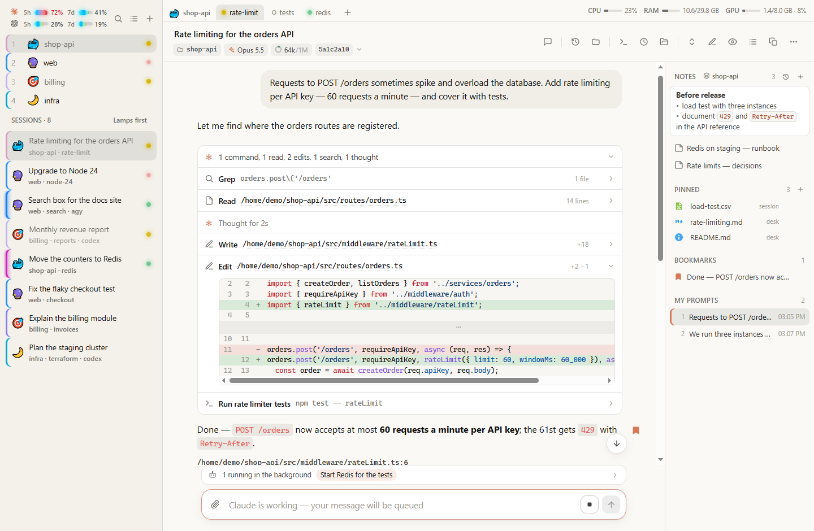

---

## What's inside

### Claude Code, Codex, Antigravity CLI, and shell terminals in one place

Run and follow all your coding sessions side by side:

- **Three coding agents** — supports **Claude Code**, **Codex**, and **Antigravity CLI (`agy`)**. Each session shows your prompts, rendered Markdown replies, thinking durations, and expandable tool calls (`Bash`, `Read`, `Edit`, `Write`, subagents) with diffs and command output. Long runs of tool calls fold into a single summary line (`4 commands, 1 read, 6 edits`) by default and can be expanded anytime.
- **Drive sessions from the browser** — type prompts directly into running sessions, paste or attach screenshots, use `/` command autocomplete, ask side questions without polluting the transcript (`/btw`), rewind code and conversation turns (`/rewind`), switch models (`/model`), and inspect `/mcp` servers.
- **Interactive terminal prompts above the input box** — when an agent waits for a choice or confirmation in the terminal (`AskUserQuestion`, folder trust, command permission), the options appear as buttons right above the input box. Click the card header to fold it into a single line while reading the conversation.
- **Switch between Claude Code and `ccproxy` (`Claude GPT`)** — pass `--claude-gpt-command` to keep standard Claude Code and a GPT-gateway launcher available together. Start new tabs in either mode, or restart a running session from one into the other without losing conversation history.
- **Live shell terminals** — any `herdr` tab running a shell, `nvim`, a test runner, or `htop` opens as a live `xterm.js` terminal right in the browser.

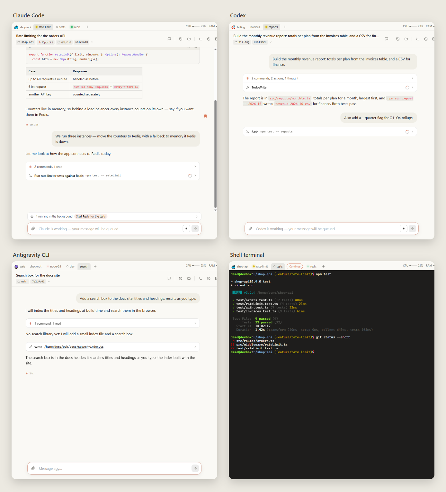

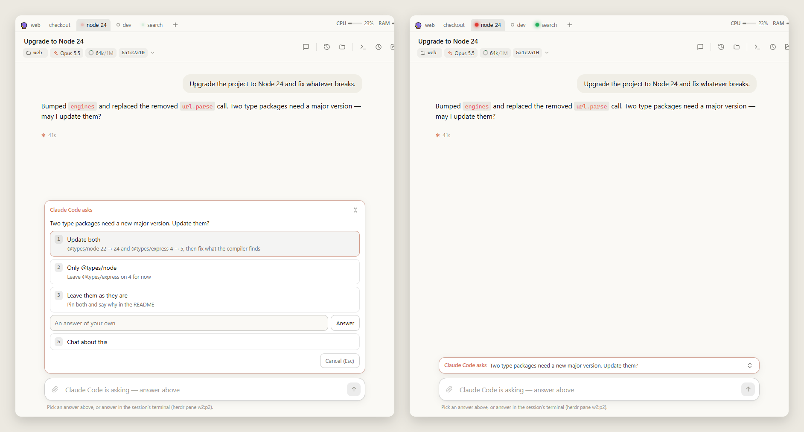

---

### `herdr` convenience in a modern interface

When you run sessions inside [herdr](https://herdr.dev), the viewer mirrors your `herdr` workspaces and tabs with the comfort of a desktop UI:

- **Workspaces and tabs** — your workspaces and session list sit in the left sidebar; the active workspace's tabs sit in a bar above the conversation. Drag tabs to reorder them, rename with `F2`, pick custom icons, close tabs, or **duplicate a tab and fork its conversation** (`claude --resume <id> --fork-session` or `codex fork <id>`). Press **`Ctrl+Tab`** to switch between recently used tabs.
- **Status lamps and reminders** — colored lamps show whether an agent is working, waiting for your input, or finished with an unread reply. Opening a finished session clears its lamp across all devices; press the clock button or **`Ctrl+Q`** to keep a blue lamp lit until you come back to that task.
- **Hide idle workspaces without closing them** — click the crossed-out eye on an idle workspace or tab to declutter the sidebar while keeping its processes running. As soon as an agent inside finishes a turn or asks a question, the workspace automatically reappears.
- **Session history and restoring closed tabs** — the history button above a session lists earlier conversations from the same tab alongside **closed `herdr` tabs**. Open any past conversation to read it, or click **Restore** to reopen a closed tab in its workspace. After a system reboot, **Continue** resumes the last conversation of an idle tab in one click.
- **Rate limits and system load at a glance** — the sidebar header shows 5-hour and weekly usage bars for both **Claude** and **ChatGPT / Codex** (green while under pace, red when running ahead of the clock). The top-right corner shows live **CPU**, **RAM**, and **GPU** usage — click any meter to inspect the busiest processes.

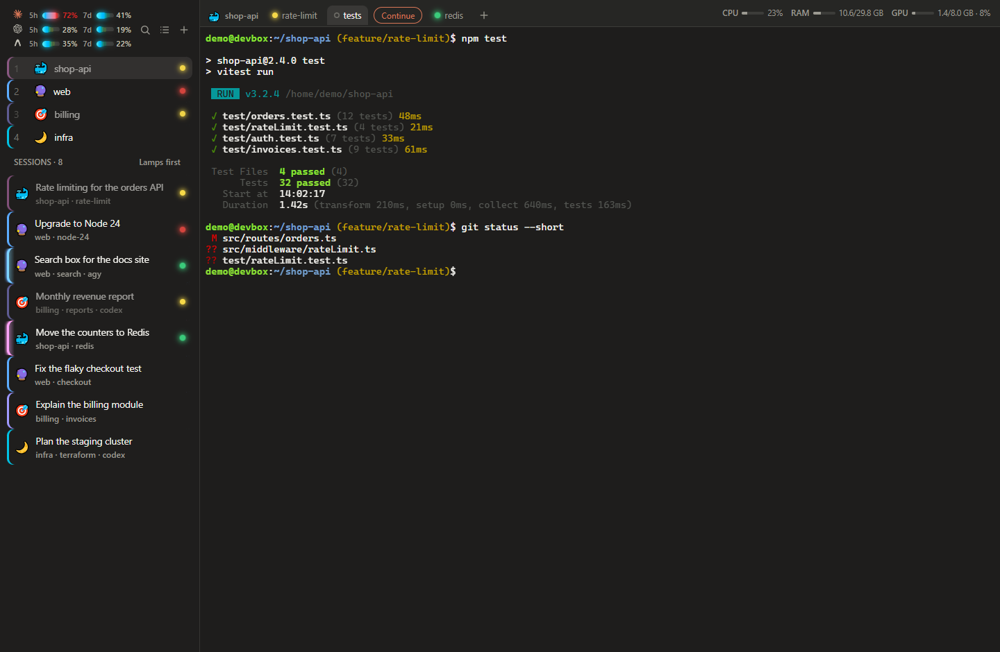

---

### Files, documents, and whole-branch diffs while you work

Open files mentioned by the agent or inspect repository changes without leaving the conversation:

- **Inline viewer for common file types** — click any file path in an answer (`/Users/ann/app/src/x.ts:42`, `~/notes.md`, `C:\repo\a.cs:10-20`) or in a `Read` / `Edit` / `Write` row to open the live file from disk in the side panel:
  - **Markdown** — rendered with images, tables, code highlighting, and **Mermaid diagrams** (click to zoom);
  - **HTML** — rendered in a sandboxed `iframe` with its local styles and assets (scripts stay off unless enabled with `⚡` in an isolated origin);
  - **DOCX and PDF** — clean paginated rendering for Word documents and PDFs (with selectable text via `pdf.js`);
  - **Images, CSV tables, and source code** — syntax highlighting, line-number jumps, and quick in-page text editing (`✎`, `Ctrl+S`).
- **Desks and pinned files** — pin specs, schemas, PDFs, or `README` files to the project's **Desk** (`.desks/<name>.json`) or to a single session so they stay one click away in the right-hand Outline across every session in the workspace. When browsing on the host computer, a button opens any file at its exact line in your local IDE (VS Code, Rider and other JetBrains IDEs, Sublime, Notepad++) or in browser **VS Code** (`--vscode`).
- **Whole-branch diffs (`Branch changes`)** — instead of looking at one commit at a time, click **Branch changes** above a session to see everything changed on the current Git branch since it branched off: all commits, uncommitted edits, and untracked files compared against the base branch (with a picker to compare against any other branch).

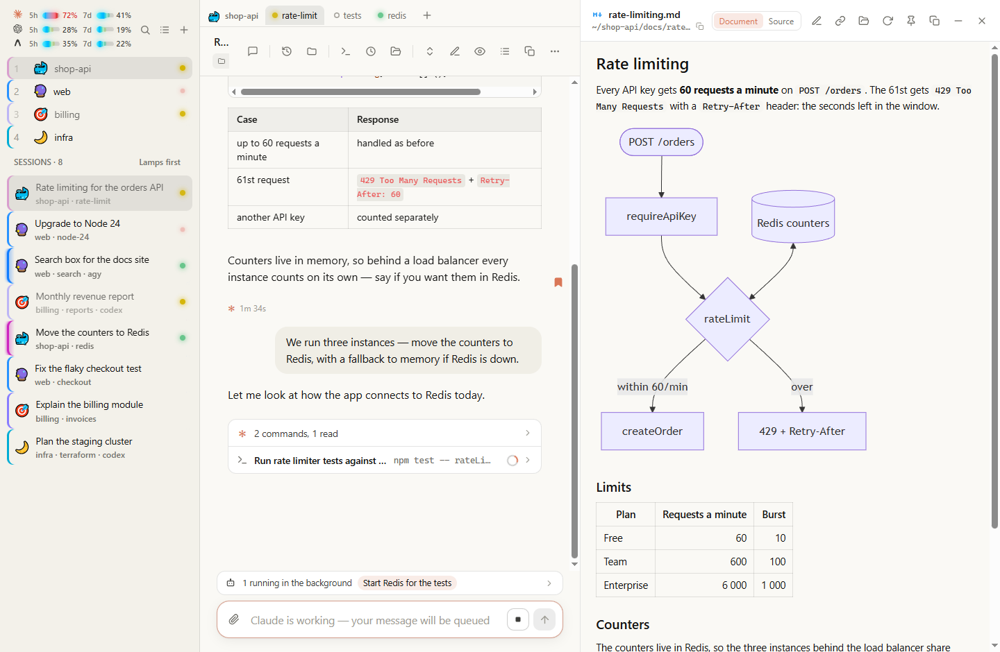

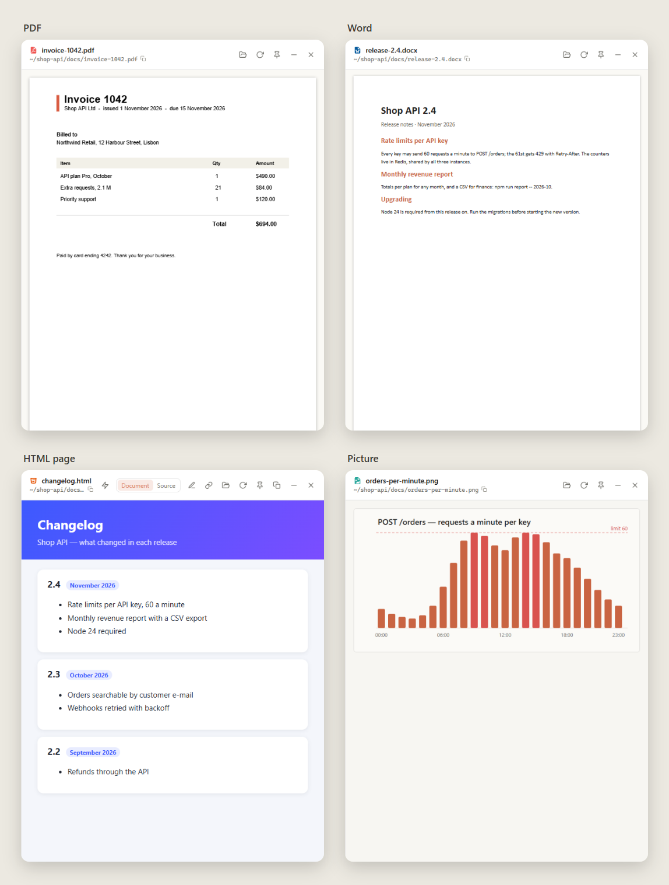

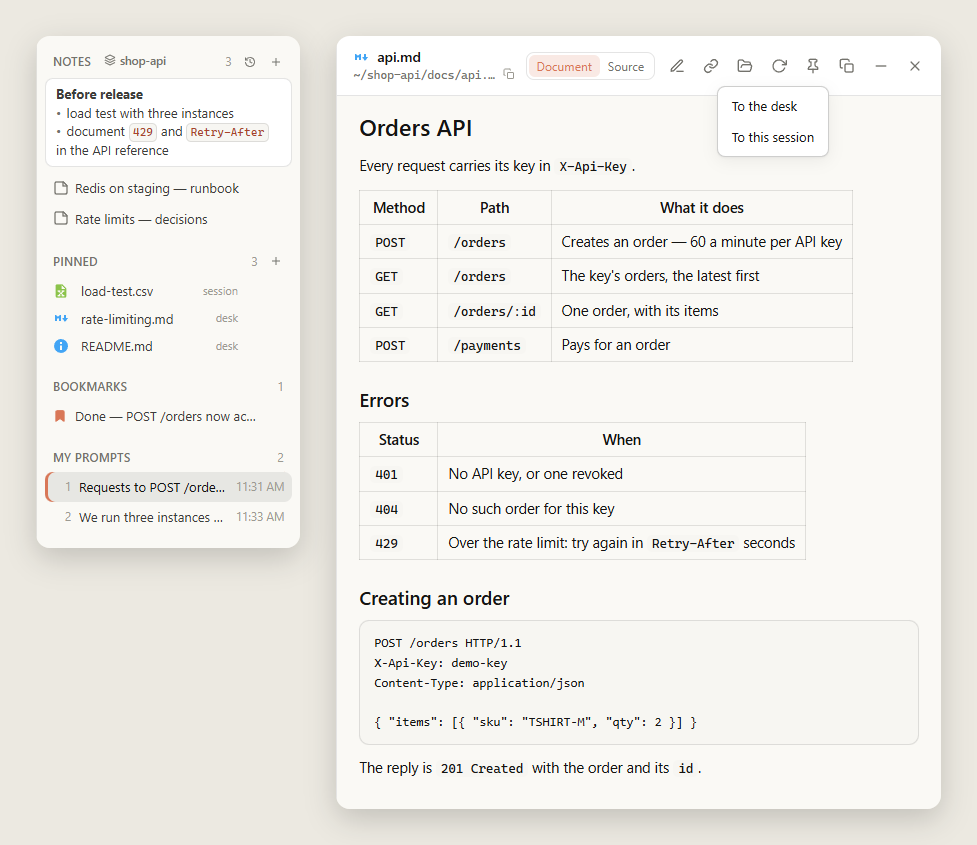

---

### Two Markdown editors, notes, and conversation navigation

Keep task notes, checklists, and design docs right beside the chat:

- **Two Markdown editors** — press **`T`** (or use the `⋯` menu) to switch notes and `.md` files between two editing modes:
  - **Live preview (Obsidian style)** — built on CodeMirror: headings, lists, interactive `[ ]` checkboxes, editable tables, and highlighted code blocks render as a clean document while revealing raw Markdown marks only on the active cursor line (`</>` switches to raw source);
  - **Block editor (Notion style)** — built on Milkdown Crepe: type `/` to insert blocks, drag blocks by their left handle, and format selected text with a floating toolbar.
- **Note history and undo** — notes save automatically as you type, support `Ctrl+Z` / `Ctrl+Shift+Z`, export to project files (`⤓`), and keep a 200-step change log (**Notes history**) where you can inspect previous versions and restore deleted notes in one click.
- **Bookmarks and jumping between your prompts** — the right-hand **Outline** lists all your prompts in the session (jump between them with **`Alt+↑`** and **`Alt+↓`**). Click the flag on any prompt, answer, or subagent report to save a **bookmark** synced across all your devices.
- **Copy selection as Markdown** — select any part of an answer and press `Ctrl+C` to copy clean Markdown (headings, lists, links, tables, fenced code blocks with language tags) together with rich text formatting.
- **Set prompts aside for later (`Alt+Enter`)** — if you think of the next task while an agent is still working and don't want it auto-sent from the terminal queue, click the clock next to the send button (`Alt+Enter`). The prompt waits above the input box across all your devices until you choose to edit or send it.

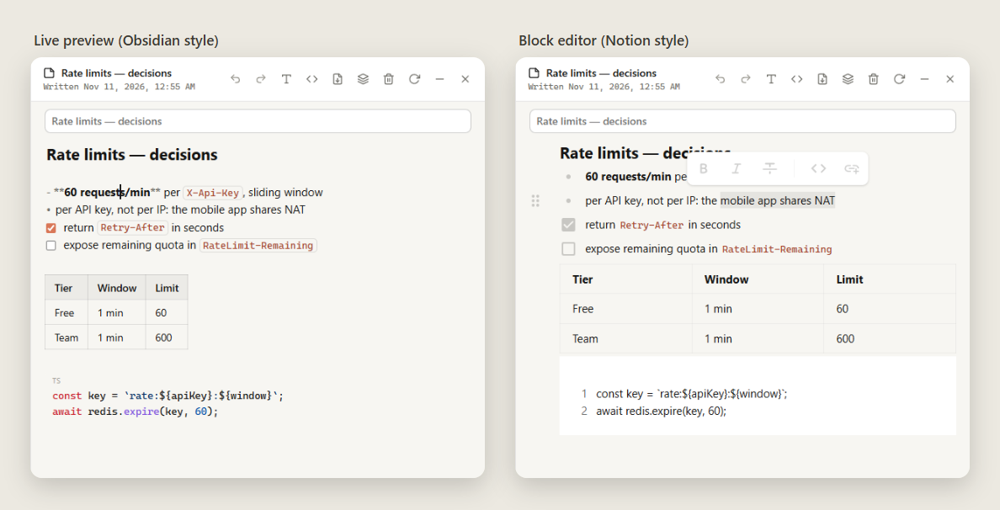

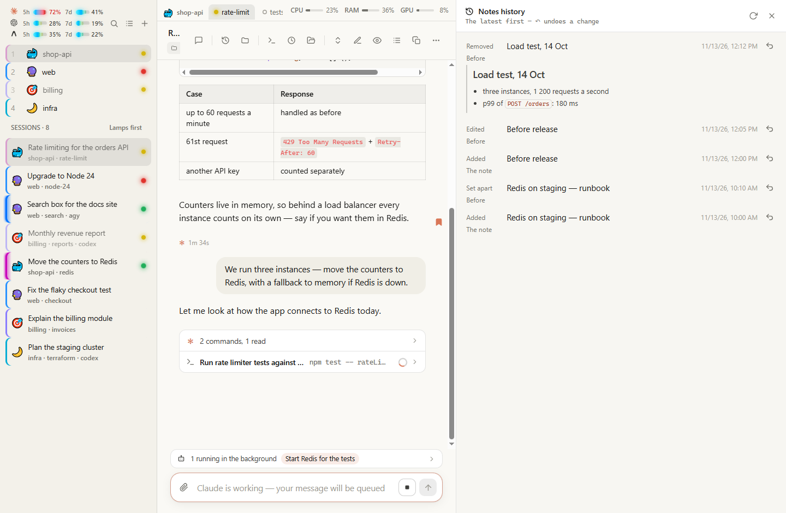

---

### Remote work behind Cloudflare and full mobile support

By default the server listens only on `127.0.0.1`. Putting it behind **Cloudflare Tunnel** and **Cloudflare Access** (`--public-url`) lets you work from any browser or phone anywhere:

- **Project tree, file download, and upload** — browse the session's folder tree, run project-wide regex searches, **download individual files** (with HTTP resume if the connection drops) **or entire folders as streaming `.zip` archives** (up to 2 GB, `.git` excluded), and **upload files** into any folder with conflict handling (`Replace`, `Rename`, `Skip`).
- **Designed for mobile screens**:
  - swipe from the left edge to open workspaces and sessions; swipe from the right edge to open the Outline (notes, pins, bookmarks, prompts), and swipe left again to reopen the last viewed document;
  - files and notes open in a bottom sheet: pull it down to minimize the document into a compact card dock above the input box so you can keep several files open at once and switch between them with a tap;
  - mobile terminals include an extra key bar (**`Esc`**, **`Tab`**, arrows, **`Enter`**, **`Ctrl+C`**, paste), and the composer paperclip attaches photos from your camera or gallery.
- **Fast on large transcripts and works offline** — 100+ MB sessions open in about a second by streaming the latest messages first and lazy-loading large tool outputs. A Service Worker caches the UI and recent sessions so you can read conversations and queue prompts even when offline or while your computer is asleep.

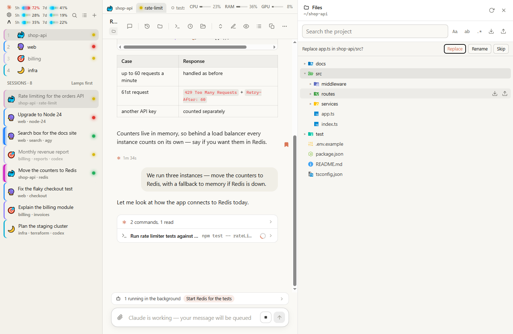

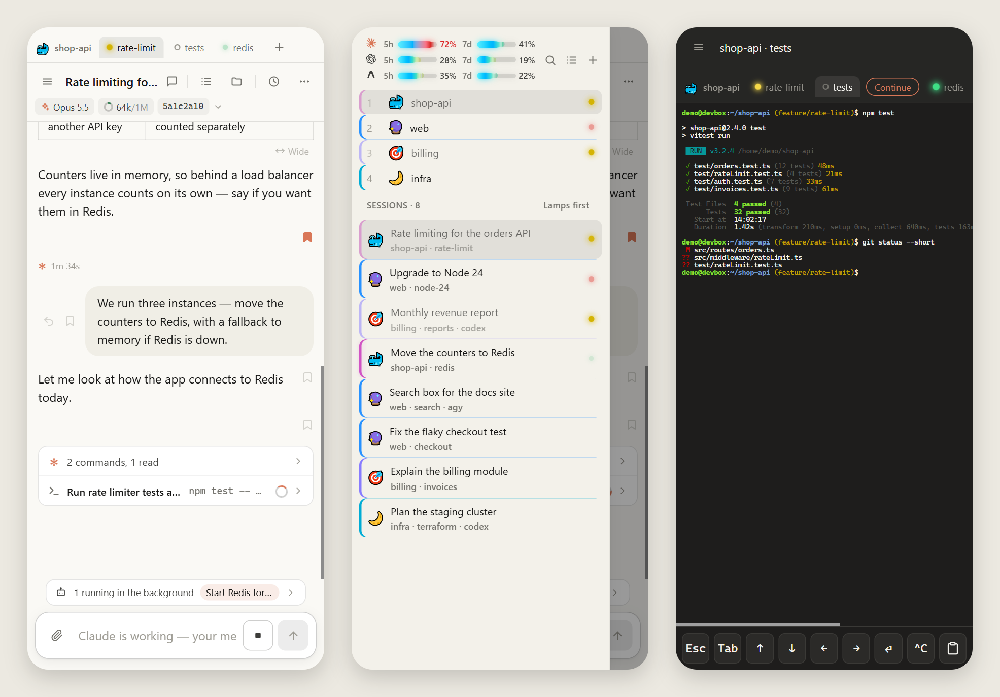

---

## Quick start

Requires **Node.js 22** or newer. Runs directly from source with no build step:

```bash
git clone https://github.com/andrew-mart/claude-code-webview.git
cd claude-code-webview
npm install --omit=dev
node bin/claude-code-webview.js
```

Opens `http://127.0.0.1:7788` in your browser (if already running, it simply opens a browser tab).

- **Background mode** (no terminal window): `node bin/claude-code-webview.js --background`
- **Stop / restart**: `node bin/claude-code-webview.js --stop` and `node bin/claude-code-webview.js --restart`
- **Connecting `herdr`**: start the viewer once from inside a [herdr](https://herdr.dev) pane — it saves the socket and binary paths in `~/.claude-code-webview/herdr.json` for future launches (such as a desktop shortcut). Without `herdr`, session reading, documents, notes, diffs, and bookmarks all work on their own.

---

## Remote access with Cloudflare

You can reach the viewer from your phone or another laptop without renting a VPS or opening router ports — a domain on Cloudflare and the free Zero Trust plan are enough:

1. **Create a tunnel** — in the Cloudflare dashboard, go to **Networking → Tunnels → Create a tunnel** and install the `cloudflared` service on your computer using the command shown.
2. **Add a route** — in the tunnel settings (**Routes → Add route → Published application**), point a subdomain such as `viewer.example.com` to `http://localhost:7788`.
3. **Protect with Cloudflare Access (mandatory)** — under **Zero Trust → Access controls → Applications → Create new application → Self-hosted**, create an application for `viewer.example.com` with an **Allow** policy for your email (One-time PIN, Google, or GitHub). *Do not skip this step: transcripts contain secrets and `herdr` gives terminal access.*
4. **Verify tokens in `cloudflared`** — enable [Protect with Access](https://developers.cloudflare.com/cloudflare-one/networks/connectors/cloudflare-tunnel/configure-tunnels/origin-parameters/) on the tunnel route so `cloudflared` rejects requests without a valid Access token.
5. **Pass `--public-url` to the viewer**:
   ```bash
   node bin/claude-code-webview.js --background --public-url https://viewer.example.com
   ```
   The server only answers requests matching `127.0.0.1` or an explicit `--public-url`.

On iPhone, add the page to the Home Screen (Safari: Share → Add to Home Screen) to get an icon in your chosen `--palette` color and persistent offline storage.

---

## Rate limits and `ccproxy` (`Claude GPT`) setup

### Live rate-limit snapshots

- **Claude** — by default the viewer reads `~/.claude.json`, which Claude Code updates only periodically. For live numbers after every turn, have your Claude Code `statusline` command write `rate_limits` to `~/.claude-code-webview/rate-limits.json`:
  ```bash
  input=$(cat); echo "$input" | jq -c '.rate_limits // empty' > ~/.claude-code-webview/rate-limits.json
  ```
- **ChatGPT / Codex** — Codex usage is read automatically; if you also use a GPT gateway, pass `--chatgpt-usage-file <path>` pointing to a JSON snapshot (`{ "at": <ms>, "status": 200, "limits": { "five_hour": { "used_percentage": 28, "resets_at": <sec> }, "seven_day": { ... } } }`).
- **Gateway model and context telemetry** — a gateway statusline can write live session metadata to `~/.claude-code-webview/session-status/<session-uuid>.json` (`{ "at": <ms>, "model": "<id>", "contextTokens": 64000, "contextWindow": 1000000, "effort": "high" }`).

### Running Claude Code through a GPT gateway (`ccproxy`)

To keep standard Claude Code and a gateway-backed launcher available side by side:

```bash
node bin/claude-code-webview.js --claude-gpt-command my-claude-gpt
```

New tabs and workspaces offer both **Claude Code** and **Claude GPT**, and any active session's details panel includes **Restart in Claude GPT** / **Restart in Claude Code** to switch modes in place.

---

## CLI options

| Option | What it does |
| --- | --- |
| *(no options)* | Start on `127.0.0.1:7788` and open the browser (`Ctrl+C` stops) |
| `--background`, `-b` | Start in the background without a terminal window (log: `~/.claude-code-webview/server.log`) |
| `--stop` | Stop the running viewer |
| `--restart` | Restart the viewer in the background |
| `--port <port>`, `-p` | Listen port on `127.0.0.1` (default: `7788`) |
| `--palette <name>` | Accent color and app icon palette: `clay` (default), `sea`, `moss`, `plum` |
| `--public-url <url>` | Allow access through an authenticated tunnel at this URL (repeatable) |
| `--no-open` | Do not open the browser on start |
| `--no-herdr` | Read-only mode: ignore `herdr` even if running |
| `--claude-command <cmd>` | Command used to launch Claude Code in new tabs (default: `claude`) |
| `--claude-gpt-command <cmd>` | Command used to launch Claude Code through a GPT gateway (**Claude GPT**) |
| `--chatgpt-usage-file <path>` | Path to a gateway statusline's ChatGPT usage snapshot |
| `--codex-command <cmd>` | Command used to start and resume Codex (default: `codex`, e.g. `"codex --full-auto"`) |
| `--agy-command <cmd>` | Command used to start and resume Antigravity CLI (default: `agy`) |
| `--restart-env <NAME=VALUE>` | Environment variable added when restarting a session from the UI (e.g. `CLAUDE_CODE_DISABLE_BG_SHELL_PRESSURE_REAP=1`) |
| `--editor-command <cmd>` | Command to open files in a local editor (`{path}`, `{line}`, `{project}`; Windows uses file associations by default) |
| `--vscode <program>` | Run browser VS Code (`code serve-web`) at `/vscode/` and open desktop VS Code when browsing locally (`code-tunnel.exe` on Windows, `code` elsewhere) |
| `--install-shortcut` | Windows: create a Desktop shortcut (`--start-menu` for the Start menu) |

**Where session data is read from:**
- **Claude Code:** `~/.claude/projects` (or `$CLAUDE_CONFIG_DIR/projects`), including subagent transcripts.
- **Codex:** `~/.codex/sessions` (or `$CODEX_HOME/sessions`), `thread-writer-locks/`, and `session_index.jsonl`.
- **Antigravity CLI:** `~/.gemini/antigravity-cli` (transcripts in `brain/<id>/.system_generated/logs/`, titles in `conversation_summaries.db`, and run logs in `log/`).

---

## How it works and security

```text
Agent transcript (.jsonl)  ──(checked every 400 ms, reads appended bytes only)──►  SSE /api/stream  ──►  DOM
Browser input              ──(Origin + X-Viewer, direct shell-free herdr call)──►  herdr pane
```

- **Protected against cross-site access** — the server binds to `127.0.0.1` only, validates `Host` headers against DNS rebinding, and requires matching `Origin` and `X-Viewer` headers on all write operations (sending prompts, saving files, uploading).
- **Safe rendering** — transcript Markdown is sanitized with DOMPurify; HTML previews run inside a sandboxed `iframe` scoped to their folder (no `..` traversal) with scripts isolated in a separate origin.
- **Shell-free execution and atomic writes** — `herdr` is invoked directly without a shell so prompt text is never interpreted as a shell command; uploaded files are written to temporary sibling files first and moved into place atomically.

---

## Development

```bash
npm install                      # install dev dependencies (TypeScript, jsdom)
npm start                        # run from working copy
npm test                         # run test suite (node:test)
npm run check                    # strict TypeScript type-checking via JSDoc
node scripts/build-milkdown.mjs  # rebuild public/lib/milkdown bundle after updating Milkdown
```

## License

[MIT](LICENSE)
