# Claude Code Webview

[Русская версия](README.ru.md) · [Quick start](#quick-start) · [What's inside](#whats-inside) · [Mobile & remote](#remote-work-and-mobile-ui) · [Configuration & CLI](#configuration-and-cli-options)

A browser workspace for **[Claude Code](https://code.claude.com)**, **Codex**, **Antigravity CLI (`agy`)**, and **shell terminals**.

Instead of juggling separate terminal tabs, document windows, and a background IDE, you get one browser window with your workspaces and sessions on the left, live agent conversations in the middle, and project files, pinned specs, notes, and whole-branch Git diffs on the right. It works standalone out of the box, or mirrors your live **[herdr](https://herdr.dev)** workspaces and tabs so you can drive running sessions from a desktop monitor or a phone.

<picture>
  <source media="(prefers-color-scheme: dark)" srcset="docs/screenshot-dark.png">
  <source media="(prefers-color-scheme: light)" srcset="docs/screenshot.png">
  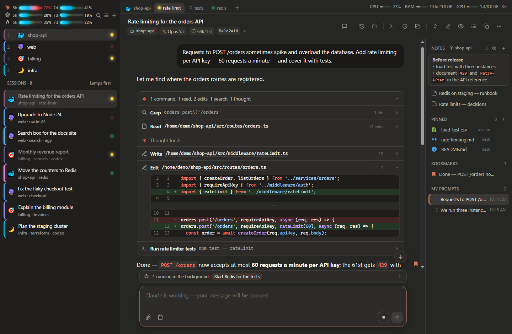
</picture>

<sub>Theme previews: <a href="docs/screenshot.png">Light theme</a> · <a href="docs/screenshot-dark.png">Dark theme</a></sub>

---

## Quick start

Requires **Node.js 22** or newer. Runs directly from source with no build step:

```bash
git clone https://github.com/andrew-mart/claude-code-webview.git
cd claude-code-webview
npm install --omit=dev
node bin/claude-code-webview.js
```

Opens `http://127.0.0.1:7788` in your browser (if already running, it simply opens a tab).

- **Standalone or with `herdr`** — without `herdr`, session reading, project files, documents, notes, whole-branch diffs, and bookmarks all work on their own. To drive live sessions, start the viewer once from inside a [herdr](https://herdr.dev) pane (it saves the socket path in `~/.claude-code-webview/herdr.json` for future launches).
- **Background mode** (no terminal window): `node bin/claude-code-webview.js --background` (`--stop` and `--restart` to manage).

---

## What's inside

### 1. Claude Code, Codex, Antigravity CLI, and shell terminals in one place

- **Three coding agents side by side** — renders prompts, Markdown replies, thinking times, and expandable tool calls (`Bash`, `Read`, `Edit`, `Write`, subagents). Long runs of tool calls fold into a compact summary line (`4 commands, 1 read, 6 edits`) by default.
- **Drive sessions from the browser** — send prompts, click any `👉` question in an answer to quote it into the input box, attach or paste screenshots, use `/` command autocomplete, ask side questions (`/btw`), rewind turns (`/rewind`), switch models (`/model`), and inspect `/mcp` servers.
- **Interactive terminal prompts as buttons** — when an agent waits for a choice or confirmation in the terminal (`AskUserQuestion`, folder trust, command permission), the options appear as clickable buttons right above the input box.
- **Claude GPT (`ccproxy`) and live `xterm.js` terminals** — switch tabs between standard Claude Code and a GPT-gateway launcher (`--claude-gpt-command`) in place without losing history, or open any `herdr` shell, `nvim`, test runner, or `htop` tab as a live browser terminal.

<table>
  <tr>
    <td width="50%" valign="top">
      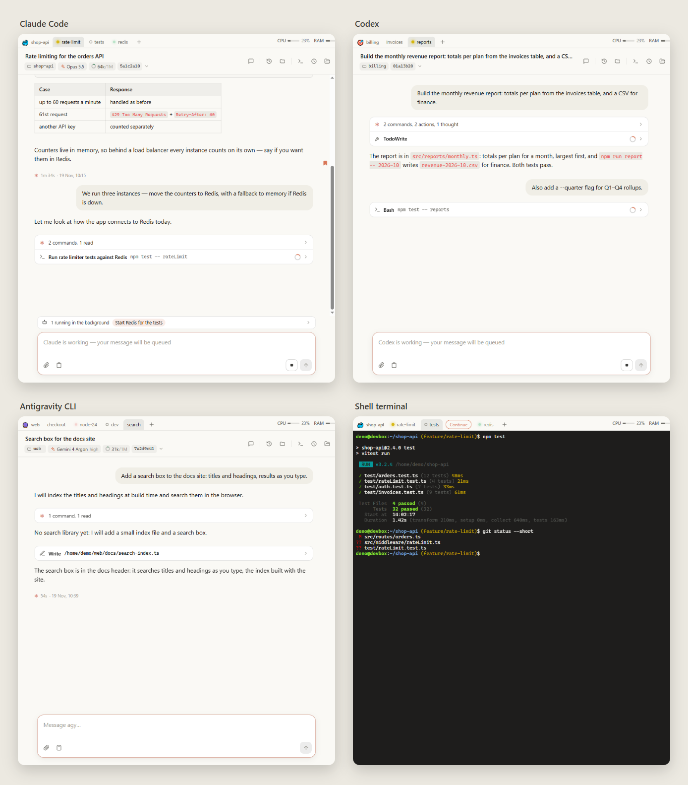
      <sub><b>Claude Code, Codex, Antigravity CLI, and a live shell tab</b> in the same workspace.</sub>
    </td>
    <td width="50%" valign="top">
      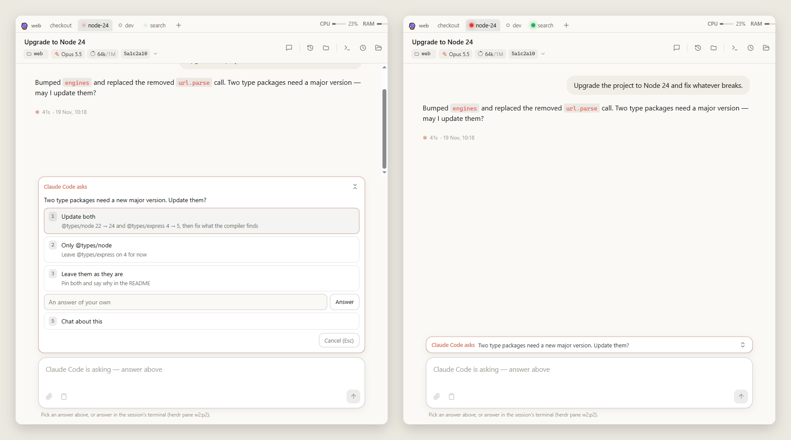
      <sub><b>Interactive agent questions</b> appear as buttons above the input box (expanded and folded).</sub>
    </td>
  </tr>
</table>

---

### 2. `herdr` workspaces, status lamps, and live usage bars

- **Workspaces, tabs, and conversation forking** — workspaces and sessions sit in the left sidebar; the active workspace's tabs sit above the chat. Reorder tabs, rename with `F2`, pick icons, switch with `Ctrl+Tab`, or duplicate a tab and fork its conversation (`claude --resume <id> --fork-session` / `codex fork <id>`).
- **Status lamps and reminders** — colored lamps show whether an agent is working, waiting for input, or finished with an unread reply. Press the clock button or `Ctrl+Q` to keep a blue reminder lamp lit across all devices until you come back to that task.
- **Declutter and restore** — hide idle workspaces with the crossed-out eye (they reappear automatically when an agent finishes or asks a question), browse past conversations, reopen closed `herdr` tabs with **Restore**, or resume after a reboot in one click with **Continue**.
- **Rate limits and system load at a glance** — the sidebar header displays 5-hour and weekly usage bars for **Claude**, **Codex / ChatGPT**, and **Antigravity CLI (`agy`)**, while the top-right corner shows live **CPU**, **RAM**, and **GPU** load (click to inspect top processes).

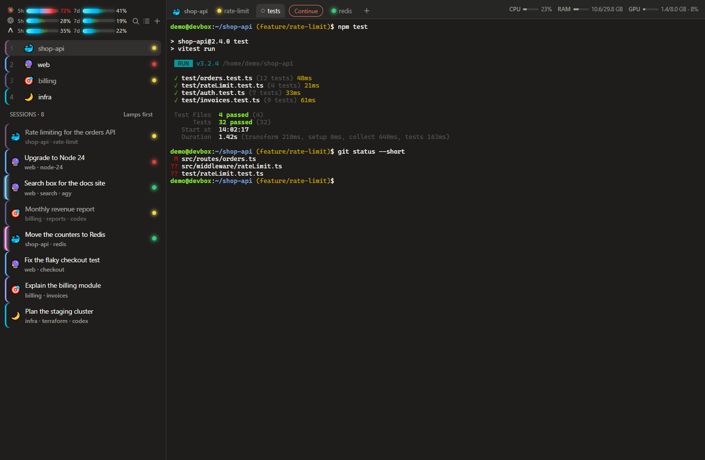

---

### 3. Project files, documents, Desks, and whole-branch diffs

- **Inline file and document viewer** — click any file path in a reply (`/src/app.ts:42`, `~/notes.md`, `C:\repo\a.cs:10-20`) or tool call to open it right at that line in the side panel:
  - **Source code, CSV, and images** — syntax highlighting, line jumps, and quick in-page text editing (`✎`, `Ctrl+S`);
  - **Markdown and HTML** — rendered Markdown with zoomable **Mermaid diagrams**, plus sandboxed HTML previews;
  - **PDF and DOCX** — clean paginated rendering for Word documents and PDFs with selectable text.
- **Project Desks and local IDE links** — pin specs, schemas, PDFs, or `README` files to a project's **Desk** (`.desks/<name>.json`) or to a session so they stay one click away in the right-hand Outline. On the host machine, open any file at its exact line in VS Code, Rider / JetBrains IDEs, Sublime, Notepad++, or browser VS Code (`--vscode`).
- **Whole-branch diffs (`Branch changes`)** — inspect everything changed on the current Git branch since it branched off (all commits, uncommitted edits, and untracked files together) against the base branch or any other branch.

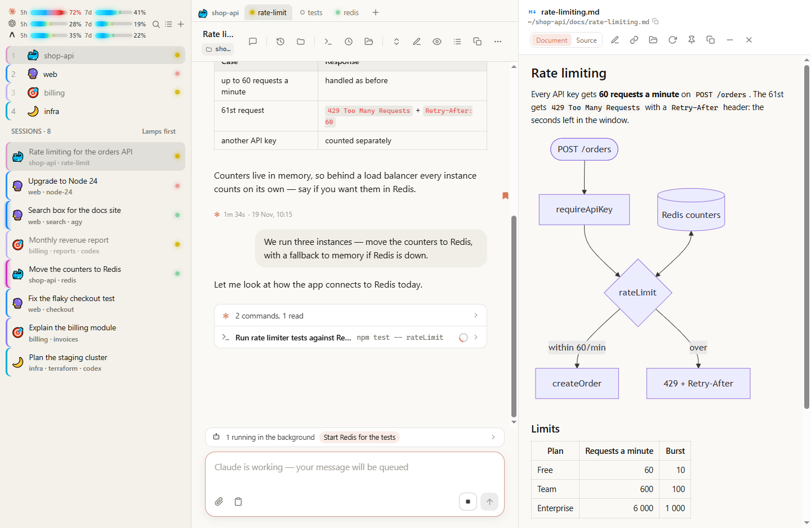

<table>
  <tr>
    <td width="50%" valign="top">
      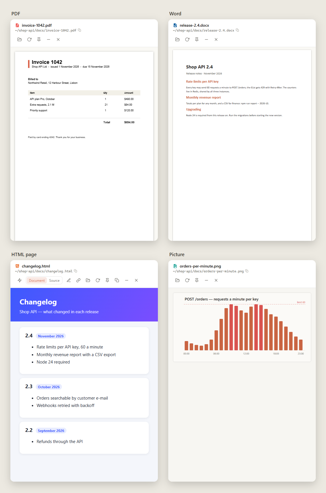
      <sub><b>Inline rendering</b> for PDFs, Word docs, HTML reports, and images.</sub>
    </td>
    <td width="50%" valign="top">
      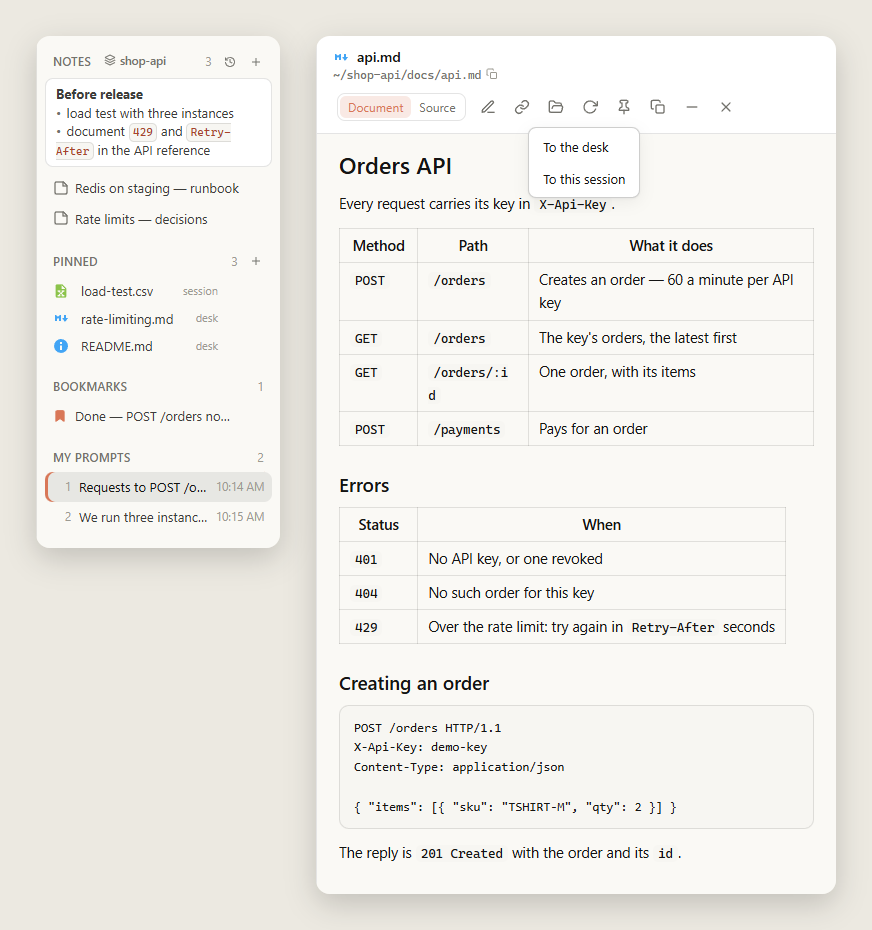
      <sub><b>Project Desks:</b> pin specs, files, and notes to the workspace or session.</sub>
    </td>
  </tr>
</table>

---

### 4. Two Markdown editors, notes history, and conversation navigation

- **Two Markdown editing modes (`T`)** — switch notes and `.md` files on the fly between an **Obsidian-style live preview** (CodeMirror, revealing raw marks only on the active line) and a **Notion-style block editor** (Milkdown Crepe with `/` commands and drag handles).
- **200-step note history** — notes auto-save as you type, export to project files (`⤓`), and keep a 200-step change log (**Notes history**) to inspect diffs or restore deleted notes in one click.
- **Prompt outline, bookmarks, and clean Markdown copy** — jump between your prompts in long transcripts (`Alt+↑` / `Alt+↓`), flag important answers or subagent reports as cross-device **bookmarks**, and press `Ctrl+C` on any selection to copy clean Markdown with headings, tables, links, and code blocks intact.
- **Park prompts for later (`Alt+Enter`)** — save follow-up prompts into a synced list above the input box while an agent is still working, without pushing them into the terminal's auto-send queue.

<table>
  <tr>
    <td width="50%" valign="top">
      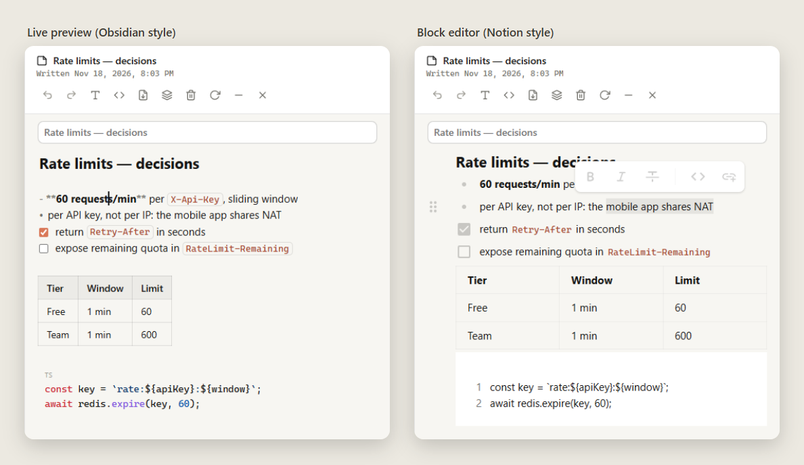
      <sub><b>Two Markdown editors:</b> Obsidian-style live preview and Notion-style block editor.</sub>
    </td>
    <td width="50%" valign="top">
      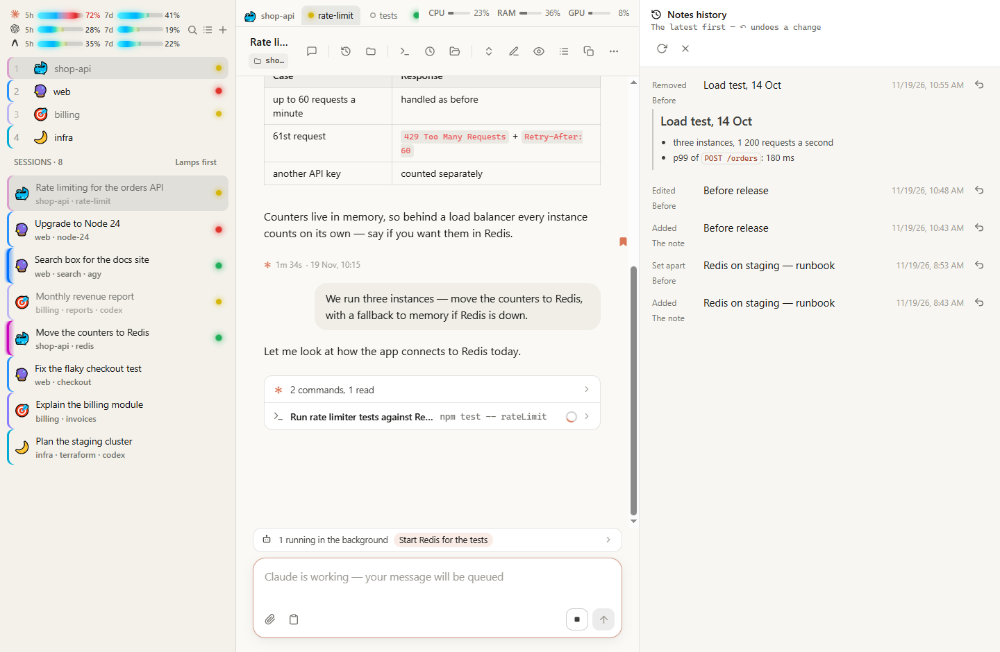
      <sub><b>Notes history:</b> 200-step version log with one-click restore.</sub>
    </td>
  </tr>
</table>

---

### 5. Remote work and mobile UI

- **Project tree, upload, and streaming `.zip` download** — browse folders, run project-wide regex searches, upload files with conflict handling (`Replace`, `Rename`, `Skip`), and download individual files (with HTTP resume) or entire folders as streaming `.zip` archives (up to 2 GB, `.git` excluded).
- **Built for phone screens** — edge swipes switch between workspaces, the session, the Outline, and the last viewed document; files minimize into a compact card dock above the input box; mobile terminals include an extra key bar (`Esc`, `Tab`, arrows, `Enter`, `Ctrl+C`, paste).
- **Fast on 100+ MB transcripts and offline-ready** — streams the latest turns first, lazy-loads large tool outputs, and caches the UI and recent sessions in a Service Worker so you can read and queue prompts offline.

<table>
  <tr>
    <td width="50%" valign="top">
      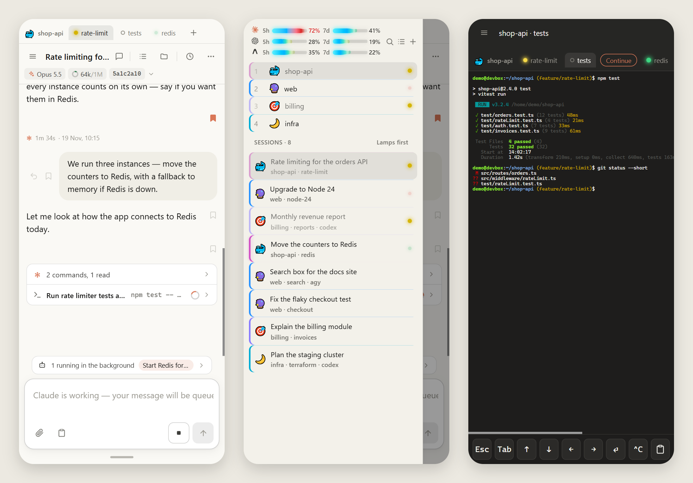
      <sub><b>Mobile UI:</b> session view, herdr workspace drawer, and dark terminal with key bar.</sub>
    </td>
    <td width="50%" valign="top">
      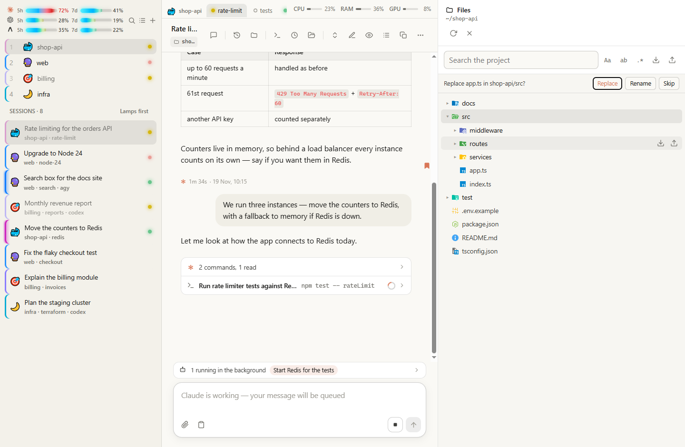
      <sub><b>File manager:</b> regex search, uploads, and streaming <code>.zip</code> folder downloads.</sub>
    </td>
  </tr>
</table>

---

## Configuration and CLI options

<details>
<summary><strong>Remote access with Cloudflare Tunnel &amp; Access (5-step setup)</strong></summary>

<br>

You can reach your workspace from a phone or another laptop without renting a VPS or opening router ports using a domain on Cloudflare and the free Zero Trust plan:

1. **Create a tunnel** — in the Cloudflare dashboard, go to **Networking → Tunnels → Create a tunnel** and install `cloudflared` on your machine.
2. **Add a route** — under **Routes → Add route → Published application**, point a subdomain (e.g. `viewer.example.com`) to `http://localhost:7788`.
3. **Protect with Cloudflare Access (mandatory)** — under **Zero Trust → Access controls → Applications → Create new application → Self-hosted**, create an application for `viewer.example.com` with an **Allow** policy for your email (One-time PIN, Google, or GitHub). *Do not skip this step: transcripts contain secrets and `herdr` gives terminal access.*
4. **Verify tokens in `cloudflared`** — enable [Protect with Access](https://developers.cloudflare.com/cloudflare-one/networks/connectors/cloudflare-tunnel/configure-tunnels/origin-parameters/) on the tunnel route so `cloudflared` rejects requests without a valid Access token.
5. **Pass `--public-url` to the viewer**:
   ```bash
   node bin/claude-code-webview.js --background --public-url https://viewer.example.com
   ```
   The server only answers requests matching `127.0.0.1` or an explicit `--public-url`.

On iPhone, add the page to the Home Screen (Safari: Share → Add to Home Screen) to get an icon in your chosen `--palette` color and persistent offline storage.

</details>

<details>
<summary><strong>Live rate-limit snapshots &amp; <code>ccproxy</code> (Claude GPT) setup</strong></summary>

<br>

#### Live rate-limit snapshots

- **Claude** — by default the viewer reads `~/.claude.json`. For live numbers after every turn, have your Claude Code `statusline` command write `rate_limits` to `~/.claude-code-webview/rate-limits.json`:
  ```bash
  input=$(cat); echo "$input" | jq -c '.rate_limits // empty' > ~/.claude-code-webview/rate-limits.json
  ```
- **ChatGPT / Codex** — Codex usage is read automatically; if you also use a GPT gateway, pass `--chatgpt-usage-file <path>` pointing to a JSON snapshot (`{ "at": <ms>, "status": 200, "limits": { "five_hour": { "used_percentage": 28, "resets_at": <sec> }, "seven_day": { ... } } }`).
- **Antigravity CLI (`agy`)** — have your `agy` `statusLine` command write `{ "model": ..., "quota": ... }` from stdin to `~/.claude-code-webview/agy-statusline.json` to display the third usage row in the sidebar header.
- **Session model and context telemetry** — a gateway or `agy` statusline can also write live session metadata to `~/.claude-code-webview/session-status/<session-uuid>.json` (`{ "at": <ms>, "model": "<id>", "contextTokens": 64000, "contextWindow": 1000000, "effort": "high" }`).

#### Running Claude Code through a GPT gateway (`ccproxy`)

```bash
node bin/claude-code-webview.js --claude-gpt-command my-claude-gpt
```

New tabs and workspaces offer both **Claude Code** and **Claude GPT**, and any active session's details panel includes **Restart in Claude GPT** / **Restart in Claude Code** to switch modes in place.

</details>

<details>
<summary><strong>All CLI options &amp; where session data is read from</strong></summary>

<br>

| Option | What it does |
| --- | --- |
| *(no options)* | Start on `127.0.0.1:7788` and open the browser (`Ctrl+C` stops) |
| `--background`, `-b` | Start in the background without a terminal window (log: `~/.claude-code-webview/server.log`) |
| `--stop` / `--restart` | Stop or restart the background viewer |
| `--port <port>`, `-p` | Listen port on `127.0.0.1` (default: `7788`) |
| `--palette <name>` | Accent color and app icon palette: `clay` (default), `sea`, `moss`, `plum` |
| `--public-url <url>` | Allow access through an authenticated tunnel at this URL (repeatable) |
| `--no-open` | Do not open the browser on start |
| `--no-herdr` | Read-only mode: ignore `herdr` even if running |
| `--claude-command <cmd>` | Command used to launch Claude Code in new tabs (default: `claude`) |
| `--claude-gpt-command <cmd>` | Command used to launch Claude Code through a GPT gateway (**Claude GPT**) |
| `--chatgpt-usage-file <path>` | Path to a gateway statusline's ChatGPT usage snapshot |
| `--codex-command <cmd>` | Command used to start and resume Codex (default: `codex`) |
| `--agy-command <cmd>` | Command used to start and resume Antigravity CLI (default: `agy`) |
| `--restart-env <NAME=VALUE>` | Environment variable added when restarting a session from the UI |
| `--editor-command <cmd>` | Command to open files in a local editor (`{path}`, `{line}`, `{project}`) |
| `--vscode <program>` | Run browser VS Code (`code serve-web`) at `/vscode/` and open desktop VS Code locally |
| `--install-shortcut` | Windows: create a Desktop shortcut (`--start-menu` for the Start menu) |

**Where session data is read from:**
- **Claude Code:** `~/.claude/projects` (or `$CLAUDE_CONFIG_DIR/projects`), including subagent transcripts.
- **Codex:** `~/.codex/sessions` (or `$CODEX_HOME/sessions`), `thread-writer-locks/`, and `session_index.jsonl`.
- **Antigravity CLI:** `~/.gemini/antigravity-cli` (transcripts in `brain/<id>/.system_generated/logs/`, titles in `conversation_summaries.db`, and run logs in `log/`).

</details>

<details>
<summary><strong>How it works, security, and development</strong></summary>

<br>

```text
Agent transcript (.jsonl)  ──(checked every 400 ms, reads appended bytes only)──►  SSE /api/stream  ──►  DOM
Browser input              ──(Origin + X-Viewer, direct shell-free herdr call)──►  herdr pane
```

- **Protected against cross-site access** — binds to `127.0.0.1` only, validates `Host` headers against DNS rebinding, and requires matching `Origin` and `X-Viewer` headers on all write operations.
- **Safe rendering** — transcript Markdown is sanitized with DOMPurify; HTML previews run inside a sandboxed `iframe` scoped to their folder with scripts isolated in a separate origin.
- **Shell-free execution and atomic writes** — `herdr` is invoked directly without a shell so prompt text is never interpreted as a shell command; uploaded files are written to temporary sibling files first and moved into place atomically.

#### Development

```bash
npm install                      # install dev dependencies (TypeScript, jsdom)
npm start                        # run from working copy
npm test                         # run test suite (node:test)
npm run check                    # strict TypeScript type-checking via JSDoc
node scripts/build-milkdown.mjs  # rebuild public/lib/milkdown bundle after updating Milkdown
```

</details>

## License

[MIT](LICENSE)
