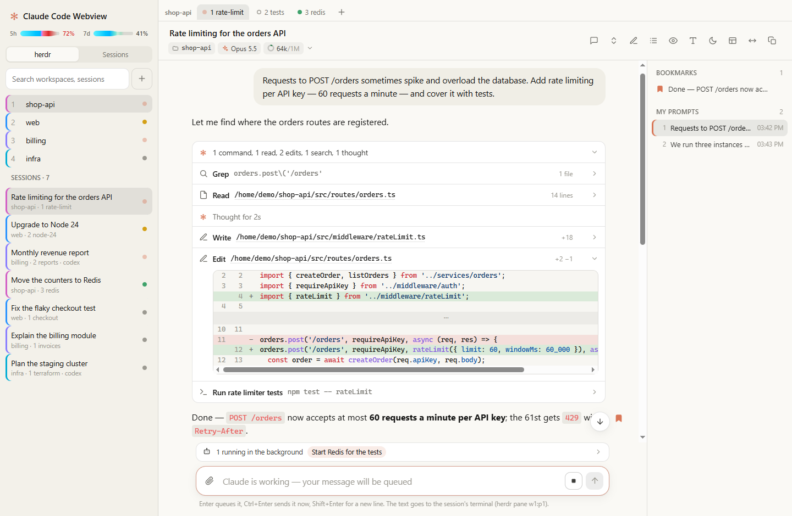
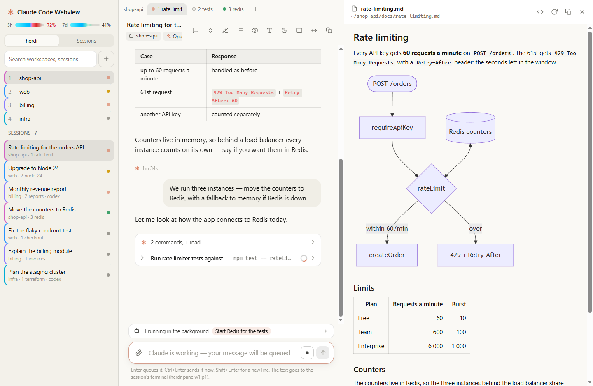
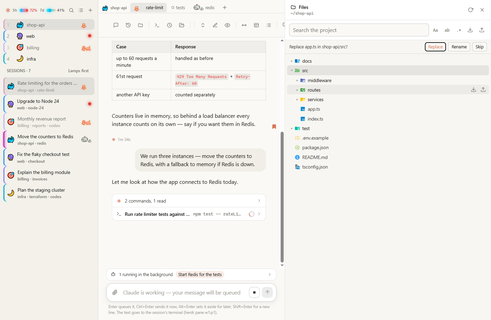
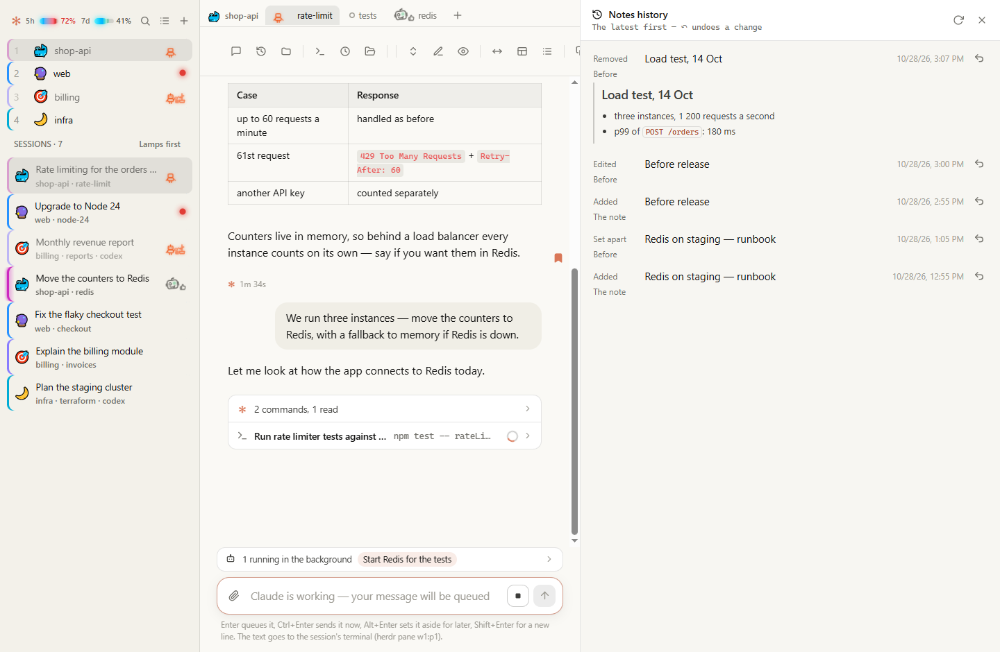
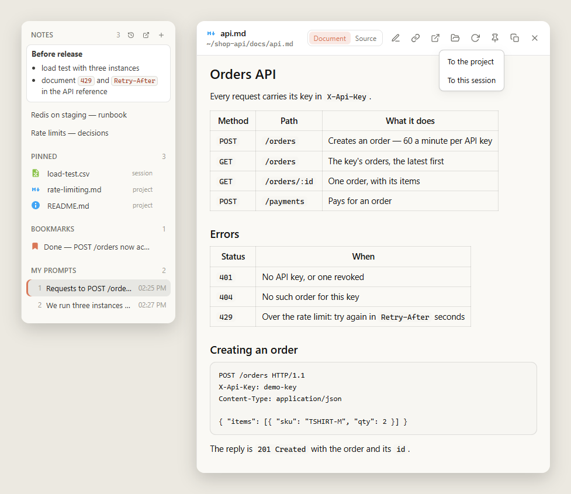
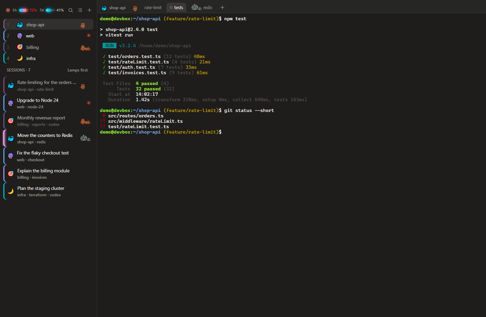
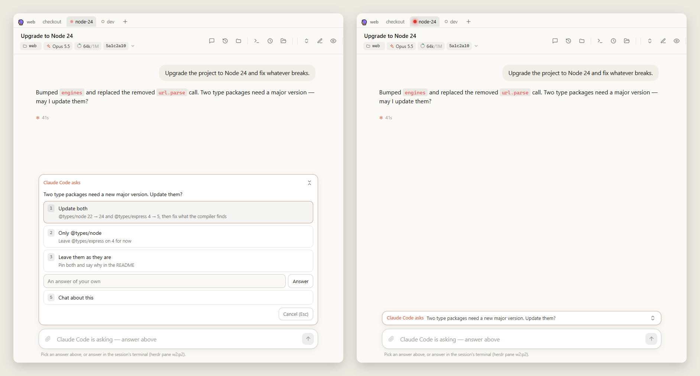
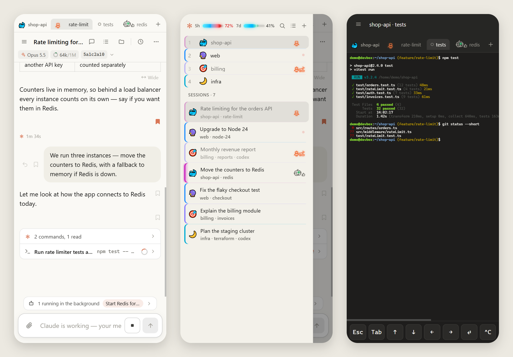

# Claude Code Webview

[Русская версия](README.ru.md)

Watch your [Claude Code](https://code.claude.com) sessions live in the browser, laid out the way Claude Desktop shows
them: your prompts in bubbles, answers in rendered markdown, tool calls folded into compact rows with diffs and output.
Every line Claude Code writes to the session transcript shows up on the page within half a second.



## Quick start

The viewer runs from its source. Requires Node.js 22 or newer.

```bash
git clone https://github.com/andrew-mart/claude-code-webview.git
cd claude-code-webview
npm install --omit=dev
node bin/claude-code-webview.js
```

The viewer starts on http://127.0.0.1:7788 and opens in your browser. If it is already running, the command just
opens the browser. Press Ctrl+C to stop; `node bin/claude-code-webview.js --background` runs it without a terminal
window. To update: `git pull`, `npm install --omit=dev`, then `node bin/claude-code-webview.js --restart`.

## What you get

- **All sessions** of every project, newest first, with titles, project folder and age; an orange dot marks a session
  written to in the last two minutes. "Follow the active session" switches to whichever session was written to last.
  A session started just now is there before its first message too — untitled, in its folder, as Claude Code has it
  open. Sessions that a program drives (`claude -p`, the Agent SDK) are hidden until you tick "Show SDK sessions". These
  options open from the sliders at the sidebar's head — one row, the account's usage and its buttons, so the lists get
  the height; the magnifier opens the search in its place, Escape or ✕ closes it.
- **Codex sessions** beside Claude Code's, marked `codex`: prompts, answers, reasoning summaries, commands with their
  output, patches by the files they change, plans as task lists. `codex exec` runs and subagents count as driven by a
  program. A Codex session running in herdr is written to from the page as Claude Code's is: Enter sends, and while
  Codex works Enter queues the message (Codex's Tab) and Ctrl+Enter puts it into the turn under way (Codex's Enter);
  Stop is Esc. While Codex asks something in its terminal — trusting a folder, an update — nothing is typed: its picker
  would take the Enter. A closed Codex session opens again with `codex resume`. Side questions (`/btw`) and rewinding
  stay Claude Code's.
- **The feed**:
  - prompts with images, slash commands and `!` shell commands with their output;
  - answers in markdown with syntax highlighting, a line break kept as a line break, as in the terminal;
  - thinking with its duration (Claude Code usually does not store the thinking text — then only the duration is shown);
  - tool calls as one-line rows that expand: Bash shows the command and output, Read the file with line numbers,
    Edit and Write a diff with line numbers, Agent its task, report and a live view of the subagent's own transcript;
  - markers for interrupts, background task results, context compaction, API errors and turn duration.
- **Show briefly / Show in detail.** Briefly (default) folds each run of tool calls into one line —
  `4 commands, 1 read, 6 edits, 5 thoughts · 1 error` — like Claude Code itself; the call that is running right now
  stays visible. In detail shows every call.
- **File links.** Absolute paths in answers (`/Users/ann/app/src/x.ts:42`, `~/notes.md`, `C:\repo\a.cs:10-20`),
  `file:///` links and paths in Read/Edit/Write rows open the file in a side panel, scrolled to and highlighting the line.
  The panel shows the file as it is on disk now, not at the time of the answer, drawn by what it is by
  [file-views](https://github.com/andrew-mart/file-views):
  - markdown as a document — its pictures and links read from its folder, mermaid diagrams drawn as wide as the panel,
    a wider one smaller to fit, a click showing it at its own size; the button over the panel shows its source, and a
    link to one of its lines opens the source there;
  - a CSV table with its columns coloured, a text file with its web addresses as links, code highlighted, a picture;
  - an HTML page with what lies beside it, in a sandbox, its scripts off until the ⚡ button runs them;
  - a Word document as its pages, fitted to the panel, its styles and links checked;
  - a PDF as its pages, their text selectable, drawn by pdf.js as they come into view.

  Text that is not UTF-8 is read as Windows-1251. A button opens the file in your editor — in a browser on the
  viewer's own computer, where the editor shows up. On Windows it is the program set for the file's kind, as a double
  click in Explorer would use: at the marked line for the editors that take one — Rider and the other JetBrains IDEs in
  the file's project (the nearest folder above it with a `.sln`, `.slnx` or `.git`), VS Code in its git work tree,
  Notepad++, Sublime Text; any other program as a double click opens it; a kind with no program set has Windows ask
  which. A kind of file whose program would run it — a script, `.reg`, `.exe` — opens in the program set to edit it,
  or not at all. `--editor-command` sets one editor for every file instead, and is how there is one off Windows. A
  page opened through a tunnel finds out where the browser is by asking the viewer at the browser's 127.0.0.1 whether
  it is the same one: Chrome asks once to let the page reach apps on the device. In such a browser one more button over
  a file shows it in its folder in the computer's file manager — Explorer and Finder pick it out, elsewhere `xdg-open`
  opens its folder — and one over a session opens the session's folder there; a browser on another computer or a phone
  has neither.

  
- **Branch changes.** A button over a session shows in the side panel what the branch checked out in its folder
  changed since it was made — its commits and its files, what is not committed yet included, new files too — against
  the branch it was made from, as git recorded making it; with no such record, the main branch; on the main branch
  itself, what it was pushed to. Another base can be chosen among the repository's branches. A file opened shows its
  diff, and opens in the panel with a way back to the changes.
- **The project's files.** The folder button over a session shows the session's folder in the side panel as a tree,
  with a search over the project's text (case, whole word, regex); a file opened from either opens in the panel. Each
  file downloads as it is and each folder as a zip, `.git` left out; the arrow up beside a folder uploads the files
  picked into it. The two buttons beside the search go by what is chosen in the tree — the folder clicked last, or the
  file shown: the download gives that folder or file, the upload goes into that folder or the one holding the file;
  with nothing chosen, both are for the project's own folder, and their titles say which. A file whose name is there
  already is asked about: replace the one there, upload it under another name, or skip it; where the file system does
  not tell case apart (Windows, macOS) a name that differs only in case is the same file, and replacing it asks which
  of the two names it keeps. Both show their progress under the search, with a bar: an upload its share of the file
  and which of the files picked it is; a download its share of the file, or a zip — made as it goes, its size not
  known ahead — its megabytes so far. A download comes in the page first and is saved once it is all there, so one
  cut midway is not saved half. A zip holds up to 2 GB and 20,000 files; an upload takes up to 1 GB a file.

  
- **VS Code.** Started with `--vscode <the VS Code CLI>`, the viewer runs VS Code in the browser — Microsoft's own
  `code serve-web` — at `/vscode/`, and a button over a session opens it in the session's folder in a tab of its own:
  the whole of VS Code, its search, its git, its extensions and their language servers (go to a definition, find the
  uses). A button over a file in the file panel opens VS Code at the file's project — the nearest folder above it with
  `.git`, a worktree's own, else the file's folder — with the file at its line. In a browser on the viewer's own
  computer (found out as for "Open in the editor") both buttons open the computer's own VS Code instead, with its
  settings, extensions and keys: `code` itself, or on Windows `Code.exe` beside the `bin` folder of `code-tunnel.exe`.
  The first start downloads VS Code's server, about 100 MB, into `~/.vscode/cli`; its extensions are its own, in
  `~/.vscode-server`. It stops with the viewer, however the viewer stops.
- **Outline and bookmarks.** A right-hand outline lists your prompts (the one on screen is highlighted; Alt+↑ / Alt+↓
  jump between them) and your bookmarks: hover a prompt, an answer or a subagent report and click the flag to keep it
  one click away. Bookmarks are kept by the viewer in `~/.claude-code-webview/bookmarks.json`, so every browser and
  device that opens it sees the same ones.
- **Notes.** First in the outline, notes in markdown on the session's project folder: every session in the folder —
  Claude Code's, whose project stays the folder it started in after a `cd`, and Codex's — shows the same ones. A note is
  always there to be typed in, shown as it reads — a heading as a heading, a list's bullets as dots, a task's [ ] as a
  box to tick, a code block coloured by its language, a table as a table — its markdown's marks showing only where the
  cursor is, as Obsidian's live preview has it; what is saved is the markdown as typed. It is saved a second after the
  typing stops, and at once when it is left; a note may be empty. A link in a note — and a file's path — opens on
  Ctrl+click: a file in the side panel at its line, a page in a tab. The `</>` button shows a note's markdown as typed,
  and back. The note button in the session's head switches the notes to blocks, as Notion has them — Milkdown's Crepe:
  **/** makes a block, a handle on its left drags it, a toolbar comes over the words selected, a table is edited in
  place; a note typed into there is saved as Milkdown writes markdown — its lists' marks and escapes its own — and a
  note only read is not saved. **+** writes a new note set apart — in the side panel, under a name in the field above it
  (with none, its first line names it) — listed in the outline by its name, which opens it in the side panel; the button
  at the end of a name shows the note in full in the outline, and the one beside the bin sets it apart again. The bin
  removes a note once ✓ confirms. The notes stand in the order they are put in — a new one first: the grip among a
  note's buttons moves it among the others, dragged with the mouse or with a finger resting on it a moment, and every
  device shows the order alike. The clock lists the notes' changes, the latest first — added, edited, removed, set
  apart; a note's edits one after another, within ten minutes, are one — each with the text it had before and ↶, which
  puts the note back as it was: a note removed comes back, an edit is undone. Kept in
  `~/.claude-code-webview/notes.json`, as the bookmarks are, each note with its way, so every device shows it alike; the
  last 200 changes of each folder in `notes-history.json` beside it.

  
- **Pinned files.** Under the notes, the files pinned beside the session — a spec, a design, a README; any file the side
  panel shows: markdown, a page, a Word document, a PDF, a table, a picture, code. The pin over a file open in the side
  panel pins it, to the session's project folder — every session in it shows it — or to this session alone, chosen as it
  is pinned; pressed again, it unpins it. A file the viewer did not pin — gone from its path, or the viewer not
  answering — is told under the pin. A click on a pinned file opens it in the side panel, × unpins it; each is marked by
  where it is pinned. **+** over the list pins a file by its path, typed or pasted in — to the project or to the
  session; a path with no file there is refused, saying so. ✎ on a row names the file in the list as you like, the
  file's own name left as it is. Kept in `~/.claude-code-webview/pins.json`, so every device shows them.

  
- **Session header.** Under the title, one line of facts: the folder, the branch checked out there now, the model and
  its effort, a ring that fills as the context window does (`412k/1M`; amber past 70%, red past 90%) and the cost.
  A click opens the details: the full path and how much context is used and left. The window comes from the model
  as Claude Code gives it (1M for Opus 4.7+, Sonnet 5+, Haiku 5.5, Fable; 200K for earlier ones unless the session ran
  their `[1m]` variant); for a model Claude Code does not know only the size is shown.
- **Usage.** Under the viewer's name, a meter for your plan's 5-hour window and one for the week. What is used is a
  thick light-blue bar that narrows smoothly into a thinner line. While the use lags behind the time, the thin line is
  pale green — room to spare — up to how much of the window has gone by; once the use runs ahead of the time, the bar
  is red past that point — overspent. Hover for when each resets and how old the reading is. Claude Code reads
  the usage only now and then and keeps the reading in `~/.claude.json`, so it may be hours old. A statusline command
  is given a fresh one with every reply (`rate_limits` in its input); have yours drop it into
  `~/.claude-code-webview/rate-limits.json` and the viewer shows whichever reading is fresher. In a bash statusline:
  `input=$(cat); echo "$input" | jq -c '.rate_limits // empty' > ~/.claude-code-webview/rate-limits.json`.
- **Phones.** On a narrow screen the session list and the outline slide in from the sides, bookmark flags stay
  visible without hover, the view buttons fold into a "⋯" menu — the buttons over a session used less often with them,
  as its first group, so the session's title has room — and on a touch keyboard Enter starts a new line while the ↑
  button sends.
- **Long sessions** open with their latest part (2000 entries, 800 on a phone); "Show N earlier entries" above it loads
  the rest, keeping your place. A tool's big output — a command's stdout, a file read or written — is not sent up
  front: the row shows its summary, and the output loads when the row is opened. A 120 MB transcript opens in about
  a second. Images load only
  when they scroll into view, and replies are gzipped, so a long session costs a phone about a megabyte, not dozens.
- **Offline.** With the viewer out of reach — the computer off, a proxy in front of it answering with an error, no
  network — the page still opens (a service worker keeps it) and shows what this browser saved: the session list and
  the sessions you opened, plus the latest few sessions worked on, saved in the background while the viewer answered.
  "Offline · reading saved copies" shows meanwhile; once the viewer answers, the page reconnects and catches up, keeping
  your place. On an iPhone, add the page to the Home Screen: Safari may clear a website's saved data after a week
  without visits. The saved copies serve online too: a session opened again shows at once as it was last time, marked
  "Updating…" until the viewer's fresh copy takes its place. The sessions you switched away from lately stay
  connected out of sight, over the page's one stream: switching back shows them up to date at once, where you left
  them. As many stay as their size allows — about ten long ones on a computer, four on a phone, many more short ones,
  twenty at most; the last one you left always stays.
- **Background work.** Over the input box, what the session runs in the background — subagents and commands — and
  how many have ended; opened, every task with how it stands: a command with its output as it grows, a subagent with
  its own transcript as it works. A subagent quiet for long is shown as such, not as running for days.
- **Copying.** A part of an answer selected and copied comes as markdown, as the answer was written — headings,
  emphasis, code, links, lists, quotes, code blocks with their language and tables — with the formatting along with it
  for a paste that takes it. A view button turns this off, and the browser copies as it does.
- **Tables.** A table fits the answer's width, narrowing its columns down to whole words. When that is too cramped —
  on a phone especially — "Wide" under the table gives each column a comfortable width and lets the table scroll
  sideways. The same choice can be made for all tables of a session (in the header's details) or of the whole viewer
  (a view button); the table's own button overrides the session, the session overrides the viewer.
- Light and dark themes, optional display of Claude Code's service messages.
- **Palettes.** `--palette sea` (or `moss`, `plum`; `clay`, Claude's own, is the default) changes the accent colour, tints the
  session list a little and colours the tab icon and the iPhone home screen icon — two viewers, say on two computers, are
  told apart at a glance.

## With herdr: workspaces, tabs, terminals and sending prompts (optional)

herdr is not needed to read sessions. If you run Claude Code inside [herdr](https://herdr.dev), the viewer can do more:
lay herdr out as herdr does — its workspaces, their tabs with the agents' status, terminals — and type prompts into
the sessions. Without herdr — not installed, not running, or turned off with `--no-herdr` — everything else works, and
the herdr view, the terminals, the input box, Stop and rewind are simply not shown.

### herdr's layout

The sidebar switches between "herdr" and "Sessions" with the button at its head that shows the other list's icon. In
"herdr" it shows herdr's workspaces in herdr's order, each
with its agents' status — working, waiting for you, done, idle — and under them every session of every workspace:
Claude Code, Codex and other agents, those with their lamp lit — at work, waiting for you, done with an answer not seen,
kept to come back to — above the idle ones, and in each the one whose agent changed state last first, as herdr lists
its agents; or, chosen at the head of the list ("Lamps first" / "Latest first", which the browser remembers), by the
latest change alone. Above an
open session — or terminal — the tabs of its workspace sit in a row, as in herdr, to switch between them. A session or
tab with Claude Code or Codex opens its feed; any other tab — a shell, nvim, another agent — opens its terminal. Codex
keeps no record of its processes: a Codex pane shows the thread Codex holds open in the pane's folder, and when a folder
has more than one, the one whose name Codex put in the pane's title. The search finds
workspaces and sessions by name and by what runs in them.

**Ctrl+Tab** switches between herdr's tabs in the order they were opened, as an editor does: a list of them shows, each
as the session list has it — the session's title, its workspace and tab, its lamp — the one opened before this one
marked; Tab with Ctrl held moves the mark down, Shift+Tab and the arrows move it either way, the wheel too — not zooming
the page, and letting go of Ctrl opens the tab marked — Enter or a click does too, Esc leaves the tab as it was. A
browser keeps Ctrl+Tab to itself in its tabs: the page gets it in a window of its own — installed as an app, in Chrome,
Edge or Brave — or in full screen.

A finished agent's lamp goes out once its answer is seen — its session opened in the page, on any device. To come back
to one later, keep its lamp lit — blue, steady: the clock over the session, the one among an open session's buttons in
the sidebar or among the open tab's in the tab bar, or **Ctrl+Q**. It stays lit — its tab's and its workspace's too —
until you press it again or the agent starts working again; kept by the viewer in `~/.claude-code-webview/kept.json`, so
every device shows it.

A second click on the open tab shows its buttons: the first is its icon (☺ while it has none), picked there and then
without naming the tab; ✎ names it — so does **F2**, anywhere but in a terminal — the next
one duplicates it, × closes it (after asking with ✓ and ✕ — what runs in it stops), and the page moves to the tab next
to it. A duplicate is a new tab of the workspace, in the same folder, named `<name>::1` (then `::2`, …; a copy of a copy
counts on from the same name), with the session in it forked: `claude --resume <id> --fork-session` — the conversation
so far, going on as a new session, its feed showing that conversation at once, before the copy's first message — or
`codex fork <id>`; a tab with no session gets a terminal. A tab's emoji icon is
kept ahead of its name in herdr's label, so herdr shows it too. **+** at the end of the row opens a tab
beside the open one, in its folder and under the name (and icon) you give it: a terminal, or Claude Code started in it
with `claude` — or with the command given by `--claude-command`, a wrapper of your own — or Codex, with `codex` or
`--codex-command`; the page goes from the new tab's terminal to its session as soon as the agent's session starts there. When Claude Code started from the page — in a new tab or
workspace, or resuming a session — asks whether to trust its folder, the viewer answers yes: the folder is the one
you chose, and the dialog's arrows and Enter are out of reach on a phone. Tabs that do not fit the row scroll sideways
under the mouse wheel. A tab dragged along the row goes where it is let go, in herdr too — on a phone, after a finger
rests on it a moment, a swipe still scrolls the row.

A workspace has a colour of its own — its hue follows from its name — on the left edge of its row and of the rows of
the sessions that run or ran in it, and an icon left of its name, one at random until you pick one — kept for its
folder. A press on the icon at the head of its tabs, over the open session, picks another (a second click on the open
workspace's icon in the sidebar too): an emoji, which goes ahead of its name in herdr, or one of Lucide's icons, found
by its words, in a colour of your choice. **+** beside the search opens one: its folder — picked from the folders
offered under its box, or typed anew — its name, the folder's unless you give another, and a terminal, Claude Code or
Codex in it; a folder that is not there is offered to be made, and the workspace opens in it as asked. The folders
offered for what is typed are first those worked in — typed before, where sessions ran — then those on the disk: for
a path, the folders in the one it is typed in whose names start with what follows the last slash; for a word, the
folders with it in their names beside those worked in lately. They are written as the viewer's computer writes paths —
backslashes on Windows — and so is the folder a workspace opens in. A second click on the
open workspace or session in the sidebar shows its buttons, as the open tab's do: ✎ names the workspace or the
session's tab, × closes it. An idle session also gets a crossed-out eye: it hides the session from the list until its
agent changes state — it starts working, say — on every device (`~/.claude-code-webview/hidden-panes.json`). The list's
head tells how many are hidden, and a press on that brings them all back.

A terminal mirrors the one in herdr, at its size: the keys you type go to it as they are — Enter, arrows, Ctrl+C — and
what herdr shows comes back within a few hundredths of a second (the viewer talks to herdr through its socket; where
the socket is not known, through the herdr program, a fifth of a second). herdr does not tell where the cursor is, so no
cursor is drawn. On a phone the terminal's font shrinks to fit the width, down to a readable size, and it scrolls
sideways past that. A tab split into several panes shows the one running Claude Code, or else its first pane.



### Claude Code through a GPT gateway

Keep ordinary Claude Code and a gateway-backed launcher available together:

```bash
node bin/claude-code-webview.js --claude-gpt-command my-claude-gpt
```

This adds **Claude GPT** beside Claude Code when opening a tab or workspace. GPT sessions use that launcher when
reopened or duplicated, retaining their last model. Sessions launched outside the viewer are recognized by their
`gpt-*` model IDs. The ordinary Claude Code command stays separate. The gateway must be running and reachable by
the launcher.

Send `/model` from the input box to open Claude Code's model picker on the page. Clicking a model applies it to that
session only, leaving the global Claude Code default alone. The picker shows the options configured in Claude Code.

A gateway statusline can publish the session's live model and context to
`~/.claude-code-webview/session-status/<session-uuid>.json`: `{ "at": <Unix milliseconds>, "model": "<model-id>",
"contextTokens": <input tokens including cache>, "contextWindow": <window size>, "effort": "high" }`.
Only `at` and `model` are required. The viewer reads these facts independently of transcript entries, so the model
can appear before the first answer, and uses the reported window for gateway models. A newer reading takes
precedence over older transcript messages. The file should contain only these display fields.

`--chatgpt-usage-file <path>` reads a gateway statusline's usage snapshot and shows the freshest reading beside
Codex's usage, under **ChatGPT / Codex**. The file has `{ "at": <Unix milliseconds>, "status": 200, "limits": { ... } }`;
`limits.five_hour` and `limits.seven_day` each hold `used_percentage` and `resets_at` (Unix seconds). Missing, failed,
or expired readings are hidden. Only the windows and their reading time are sent to the browser.

Codex questions issued while work continues appear in the conversation with their choices, outside folded action
groups. Reply through the input box.

### Sending prompts

An input box appears under the feed: the text is typed into
the session's terminal and submitted with Enter, exactly as if you typed it there. While Claude is busy, Claude Code
queues it. "Stop" — or Esc in the box, or anywhere on the page with nothing else to close — sends Esc. A long text pasted in
need not cover the conversation: a box taller than a few lines folds to them with the button in its corner. As in the terminal, a prompt Claude had not started on comes back for editing: the viewer
takes it out of the terminal's input box and puts it into the page's box, exactly as it was sent, before anything
already typed there. Drafts are kept per session.

What comes to mind while Claude works need not break into its turn — Claude Code's queue hands a prompt over as soon
as it can — nor be lost: the clock beside ↑ (Alt+Enter) sets the box's text aside for later. The prompts set aside
wait over the box in the order written; each goes into the box to be edited, is sent from an empty box with one tap,
or is removed. The viewer keeps them in `~/.claude-code-webview/later.json`, so the phone and the computer see the
same ones.

Images can go with a prompt: pick them with the paperclip (on a phone — from the gallery or the camera), paste a
screenshot anywhere on the page (Ctrl+V), or drop files on the box. The page scales photos down to 2048 px before sending; the viewer saves them in
`~/.claude-code-webview/uploads/` and lists their paths at the end of the prompt, and Claude Code opens them with its
Read tool. In the feed the list shows as pictures again.

A slash at the start of the box offers the session's commands over it, as the terminal's menu does, narrowed by what is
typed: Claude Code's own, the skills and command files of yours (`~/.claude/skills`, `~/.claude/commands`) and of the
session's folder (`.claude/`), and those of the plugins turned on, as `/<plugin>:<name>`; for Codex its own and your
prompts. ↑ and ↓ go through them, Enter or Tab puts one in the box — to send as it is or with arguments — and Esc puts
the list away.

`/btw <question>` in the box asks a side question, as in the terminal: Claude answers from what the conversation
already holds, with no tools, even while it is busy, and nothing is added to the conversation. Claude Code shows the
answer only in a panel over its prompt box, so the viewer reads it off the terminal — scrolling to its end — closes
the panel and shows the answer above the page's box. Prompts sent meanwhile wait until the panel is closed. The answer
belongs to its session: opening another session and coming back — even before it came — shows it again, until you close
it.

Rewind works as Esc Esc does in the terminal: the ↶ next to one of your messages offers the same choices — restore
code and conversation, the conversation, or the code, summarize from or up to that message. The viewer drives
Claude Code's `/rewind` menu with keys, checks every step on the screen (the message by its full text on the
confirmation) and closes the menu if anything looks different. It works only while Claude waits for input. After the
conversation is restored, the message comes back into the box on the page to be edited and sent again.

The feed shows only the active branch of a conversation: a rewind deletes nothing from the transcript, so the
messages it undid are left out.

### A tab's conversations

`/clear` (or `/new`), `/resume` and `/branch` go on in the same Claude Code with another conversation. Typed in a tab —
from the page or in the terminal — the page showing the conversation before goes on with the new one, its box with it,
and "Earlier in this tab" over the new one's feed opens the one before. The history button over a session shows in the
side panel the conversations of its tab — the one it runs now first, then those it went on from — and the herdr tabs
closed, the latest first, each with its conversations: a click opens one to read, and "Restore" opens the tab again in
its workspace, its latest conversation resumed and the others still its own. A conversation its tab went on from has,
in the box's place, "Resume here" — `/resume` typed into the tab, which keeps the conversation it ran in its history —
and "New tab", a copy of the tab with Claude Code resuming the conversation there. A tab is told from the others by
herdr's id of its terminal, kept with every session in `~/.claude-code-webview/workspaces.json`; a session seen before
the viewer kept it is a closed tab of its own. While a session runs in a herdr tab, a button over it takes herdr to that
tab, its workspace with it (`herdr tab focus`); and the session's details — a click on the line of its facts — offer to
restart it there: a second press confirms it, its Claude Code ends — its turn and its background commands with it — and
starts again in the tab resuming it (`<command>
--resume <id>`) — plainly, or, with the button that names them, with the variables given by `--restart-env` set ahead
of it — as PowerShell sets them on Windows,
`$env:NAME='VALUE';`, and as a POSIX shell does elsewhere, `NAME=VALUE <command>`. Say Claude Code has stopped a
session's idle background commands for want of memory: started with
`--restart-env CLAUDE_CODE_DISABLE_BG_SHELL_PRESSURE_REAP=1`, the viewer restarts it so that it no longer does. The
viewer ends Claude Code by the process its registry names, so it has to see the processes of the sessions' computer —
in a container, the host's (`pid: host`).

### Workspaces in the session list

In "Sessions" the session list shows each session's herdr workspace next to its folder (unless they are named alike), the search
finds sessions by workspace, and "Group by herdr workspace" gathers the list under the workspaces' names — the latest
worked on first, the sessions with no workspace last. A session's workspace is:

- the one whose pane runs it, while it runs — and it stays its workspace after the session ends
  (`~/.claude-code-webview/workspaces.json`);
- for a session never seen running, the workspace whose panes are open in its folder, if just one workspace has panes
  there.

### Finding herdr

To let the viewer find your herdr, start it once from a herdr pane — herdr sets `HERDR_BIN_PATH` and
`HERDR_SOCKET_PATH` there, and the viewer remembers them in `~/.claude-code-webview/herdr.json` for launches outside
herdr (for example from a desktop shortcut).

How a prompt reaches the terminal:

```
~/.claude/sessions/<pid>.json        → which process has the session open (Claude Code keeps this registry)
herdr pane list + pane process-info  → the herdr pane running that process
herdr pane send-text + send-keys     → the text and Enter, into that pane
```

Questions with options (AskUserQuestion) still need to be answered in the terminal.



## On your phone

The viewer answers on your computer only (`127.0.0.1`). To open it from a phone — at home or anywhere — put it behind
[Cloudflare Tunnel](https://developers.cloudflare.com/cloudflare-one/networks/connectors/cloudflare-tunnel/get-started/create-remote-tunnel/)
and [Cloudflare Access](https://developers.cloudflare.com/cloudflare-one/access-controls/applications/http-apps/self-hosted-public-app/),
right on the computer that runs the viewer. `cloudflared` connects out to Cloudflare, so there is no server to rent, no
port to open on the router and no address to keep track of. The free plans are enough; you need a domain on Cloudflare.

1. **Tunnel.** In the Cloudflare dashboard, **Networking → Tunnels → Create a tunnel**, and install `cloudflared` on
   the computer with the command the dashboard shows: it runs as a service and starts with the computer.
2. **Route.** In the tunnel, **Routes → Add route → Published application**: a hostname such as `viewer.example.com`
   and the service URL `http://localhost:7788`.
3. **Login.** **Zero Trust → Access controls → Applications → Create new application → Self-hosted and private**, for
   the same hostname, with the policy **Allow · Include · Emails · you@example.com** and the One-time PIN login (a code
   by email) or a Google or GitHub account. A long **Session Duration**, a month say, saves logging in again on the
   phone. Do not skip this step: without it the tunnel shows your sessions — secrets included — to anyone who finds
   the address, and with herdr lets them type into your terminals.
4. **Belt and braces.** On the route, turn on
   [Protect with Access](https://developers.cloudflare.com/cloudflare-one/networks/connectors/cloudflare-tunnel/configure-tunnels/origin-parameters/)
   (it asks for your team name and the application's AUD tag): `cloudflared` then passes on only requests that carry a
   valid Access token, even if the Access application is changed or deleted later.
5. **The viewer.** Start it with its public address:
   `node bin/claude-code-webview.js --background --public-url https://viewer.example.com`. The viewer answers only its
   own addresses, so without `--public-url` it turns away whatever comes through the tunnel.

Open `https://viewer.example.com` on the phone, log in, and add the page to the Home Screen (Safari: Share → Add to
Home Screen). It gets an icon in the viewer's palette, and Safari keeps its saved copies: with the computer off the
page still opens and shows what it saved, and catches up once the computer is back (see **Offline** above).

On a phone the session list and the outline slide in from the sides, and the swipe from the left edge — the browser's
Back — brings back the list the session was chosen in. On the touch keyboard Enter starts a new line and ↑ sends; the
paperclip takes photos from the gallery or the camera.



Several computers? Give each its own tunnel, hostname and `--palette`, and the pages are told apart at a glance.

## Commands

| Command | What it does |
| --- | --- |
| `node bin/claude-code-webview.js` | start and open the browser; Ctrl+C stops it |
| `node bin/claude-code-webview.js --background` | start without a terminal window (log: `~/.claude-code-webview/server.log`) |
| `node bin/claude-code-webview.js --stop` | stop the running viewer |
| `node bin/claude-code-webview.js --restart` | stop and start again in the background |
| `node bin/claude-code-webview.js --port 7800` | use another port |
| `node bin/claude-code-webview.js --palette sea` | another accent colour: clay (default), sea, moss, plum |
| `node bin/claude-code-webview.js --public-url https://viewer.example.com` | also answer at this address, behind a tunnel (see **On your phone**); repeat for more |
| `node bin/claude-code-webview.js --no-open` | do not open the browser |
| `node bin/claude-code-webview.js --no-herdr` | do not use herdr even if it is found: the page only reads sessions |
| `node bin/claude-code-webview.js --claude-command my-claude` | start Claude Code with this command in a tab opened from the page (default: `claude`) |
| `node bin/claude-code-webview.js --codex-command "codex --full-auto"` | start Codex with this command in a tab opened from the page, and `<command> resume <id>` to open a closed Codex session again (default: `codex`) |
| `node bin/claude-code-webview.js --restart-env CLAUDE_CODE_DISABLE_BG_SHELL_PRESSURE_REAP=1` | a variable a session restarted from the page — from its details — starts again with, `NAME=VALUE`, the value with no space, quote or `$`; repeat for more |
| `node bin/claude-code-webview.js --editor-command "code --goto {path}:{line}"` | open a file of the file panel in an editor of this computer; `{path}`, `{line}` and `{project}` — the nearest folder above the file with a `.sln`, `.slnx` or `.git` — are filled in; the program is started directly, not through a shell — on Windows name its `.exe`. Rider: `"C:/Program Files/JetBrains/Rider/bin/rider64.exe" {project} --line {line} {path}` |
| `node bin/claude-code-webview.js --vscode "C:/Users/ann/AppData/Local/Programs/Microsoft VS Code/bin/code-tunnel.exe"` | run VS Code in the browser at `/vscode/`, opened from a button over a session: the VS Code CLI — `code-tunnel.exe` of VS Code on Windows, `code` elsewhere |
| `node bin/claude-code-webview.js --install-shortcut` | Windows: desktop shortcut that starts the viewer in the background (`--start-menu` for the Start menu) |

`npm start -- <options>` does the same as `node bin/claude-code-webview.js <options>`.

`--stop` only stops a process that answers on the port as this viewer; another program on the port is left alone.
Sessions are read from `~/.claude/projects`; if you moved the Claude Code folder, `CLAUDE_CONFIG_DIR` is respected.
Codex sessions are read from `~/.codex/sessions`, or from `sessions` under `CODEX_HOME` when it is set; the threads it has
open, from its `thread-writer-locks`, and their names, from its `session_index.jsonl`.

The desktop shortcut starts the viewer from the folder it was created in: after moving the folder, create it again.

## How it works

```
~/.claude/projects/<project>/<session>.jsonl    ← Claude Code appends one line per block
        │  the server checks the size every 400 ms and reads what was appended
        ▼  only what the feed needs is kept (no file snapshots, system prompt, …)
SSE /api/stream?session=<id>
        ▼
transcript record → feed events (pure functions) → DOM
```

Subagent transcripts live next to the session (`<session>/subagents/agent-<id>.jsonl`) and are linked to their Agent
call through `agent-<id>.meta.json`. A session moved with `/cd` is found in its new folder automatically.

## Security

Transcripts contain everything the agent has seen, secrets included. So the viewer:

- listens on `127.0.0.1` only and answers only requests whose `Host` is that address (or one given with
  `--public-url`), so a web page cannot read it through DNS rebinding;
- leaves the login on a public address to whatever stands in front of it: an address given with `--public-url` must be
  behind one, such as Cloudflare Access (see **On your phone**);
- sanitizes markdown from transcripts with DOMPurify;
- accepts the one write operation — sending a prompt to a terminal — only from its own page: the request must carry
  the viewer's `Origin`, a JSON body and an `X-Viewer` header, which another site cannot send without a CORS preflight
  that the server never allows. herdr is run without a shell, so the prompt text is never interpreted as a command;
- serves file contents for the side panel (`/api/file`, any text file up to 2 MB by absolute path) under the same rules.
  An HTML page drawn in the panel, and what it loads beside it, comes from `/api/folder/…`: only from the page's folder
  and below — no `..` out, no link in it that leads out — in a sandbox, also when opened in a tab of its own. Its
  scripts are off; the button over the panel runs them in an origin of their own, out of reach of the viewer's page:
  such a page can neither read what the viewer serves nor send a prompt;
- downloads a file or a folder as a zip (`/api/file/download`, `/api/folder/download`) by absolute path, and takes an
  upload (`/api/file/upload`) only from its own page — its `Origin`, an `X-Viewer` header and a binary body — into a
  folder by absolute path, under a plain file name: no slash, no `..`. The file is written beside its place first and
  takes it once whole, so a broken upload leaves no half of it there;
- reaches VS Code (`--vscode`) only through itself: VS Code's server listens on 127.0.0.1 with a token the viewer makes,
  keeps in a file of its own and adds to each request. VS Code's page gets the token too, as a cookie of the viewer's
  address — its client opens its connection with it — so another site's page cannot read it. A request to `/vscode/` from another
  site — a picture, a form, a WebSocket — is turned away by what the browser says of where it comes from
  (`Sec-Fetch-Site`, `Origin`). VS Code reads and writes any file and has a terminal: on a public address it is as open
  as the login in front of the viewer, the same as sending prompts to a session is.

## Limitations

- After rewinding a conversation (Esc Esc) both branches stay in the transcript; the feed shows records in file order.
- Cost appears in the header only when Claude Code wrote it to the transcript.

## Development

```bash
npm install          # with the development tools: TypeScript, jsdom
npm start            # run from the working copy
npm test             # node:test — transcript parsing, file links, server, markdown (jsdom), CLI
npm run check        # TypeScript checks the JavaScript through JSDoc in strict mode
node scripts/build-milkdown.mjs  # rebuilds public/lib/milkdown — the notes' blocks editor — after updating Milkdown
```

| Folder | Contents |
| --- | --- |
| `bin/`, `cli/` | the `claude-code-webview` command: arguments, foreground/background start, stop, shortcut |
| `server/` | HTTP server, session list, transcript stream, file panel; through herdr: its layout, terminals, sending prompts |
| `public/model/` | pure functions: transcript parsing, tool rows and diffs, file links, outline, formatting |
| `public/view/` | rendering of the feed, tool rows, markdown, file panel, outline, input box, herdr view, terminal |
| `public/lib/` | Milkdown's Crepe bundled into one module and one stylesheet: kept built, as the viewer has no build step |
| `assets/`, `scripts/` | shortcut icon, and the script that draws it and the home screen icons (`public/favicons/*.png`); the Milkdown bundle's build |
| `test/` | tests |

## License

[MIT](LICENSE)
