# Claude Code Webview

[English version](README.md) · [Быстрый старт](#быстрый-старт) · [Что внутри](#что-внутри) · [Телефон и удалённый доступ](#5-удалённая-работа-и-мобильный-интерфейс) · [Настройка и параметры CLI](#настройка-и-параметры-cli)

Рабочее пространство в браузере для **[Claude Code](https://code.claude.com)**, **Codex**, **Antigravity CLI (`agy`)** и **обычных терминалов**.

Вместо разрозненных вкладок терминала, окон с документами и открытой в фоне IDE вы получаете одно приложение в браузере: слева — воркспейсы и сессии, по центру — живой диалог с агентом, справа — файлы проекта, закреплённые спеки, заметки и дифф по всей ветке Git. Приложение работает само по себе «из коробки», а при запуске с **[herdr](https://herdr.dev)** полностью повторяет его воркспейсы и вкладки, позволяя управлять сессиями за большим монитором или с телефона.

<picture>
  <source media="(prefers-color-scheme: dark)" srcset="docs/screenshot-dark.png">
  <source media="(prefers-color-scheme: light)" srcset="docs/screenshot.png">
  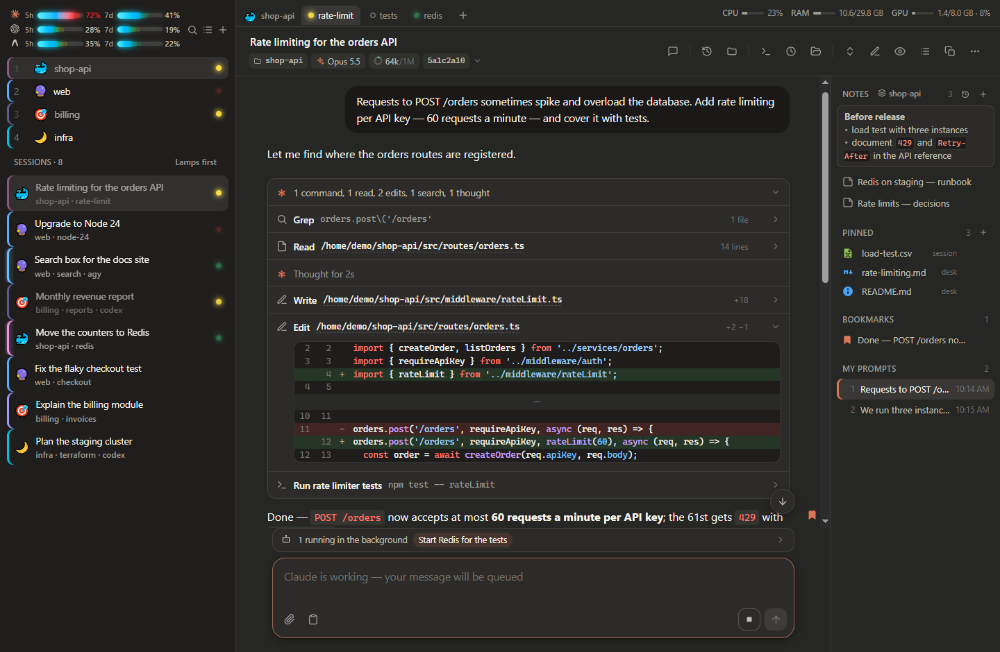
</picture>

<sub>Превью тем: <a href="docs/screenshot.png">Светлая тема</a> · <a href="docs/screenshot-dark.png">Тёмная тема</a></sub>

---

## Быстрый старт

Нужен **Node.js 22** или новее. Сборка не требуется — приложение работает прямо из исходников:

```bash
git clone https://github.com/andrew-mart/claude-code-webview.git
cd claude-code-webview
npm install --omit=dev
node bin/claude-code-webview.js
```

Откроется адрес `http://127.0.0.1:7788` (если сервер уже запущен, команда просто откроет вкладку браузера).

- **Само по себе или в связке с `herdr`** — без `herdr` чтение сессий, дерево файлов, документы, заметки, диффы веток и закладки работают сами по себе. Чтобы отправлять промпты и управлять живыми вкладками, один раз запустите просмотрщик из панели [herdr](https://herdr.dev) — он сохранит путь к сокету в `~/.claude-code-webview/herdr.json`.
- **Фоновый режим** (без окна терминала): `node bin/claude-code-webview.js --background` (управление: `--stop` и `--restart`).

*Интерфейс самой страницы — на английском языке.*

---

## Что внутри

### 1. Claude Code, Codex, Antigravity CLI и терминал в одном окне

- **Три агента рядом** — показывает промпты, отформатированные ответы, время размышлений и вызовы инструментов (`Bash`, `Read`, `Edit`, `Write`, субагенты). Длинные цепочки вызовов по умолчанию свёрнуты в одну компактную строку (`4 commands, 1 read, 6 edits`).
- **Живое управление из браузера** — отправляйте промпты, кликайте по вопросам с `👉` в ответах для быстрой вставки цитатой в поле ввода, прикрепляйте скриншоты, пользуйтесь автодополнением слеш-команд (`/`), задавайте побочные вопросы (`/btw`), откатывайте шаги (`/rewind`), переключайте модели (`/model`) и проверяйте серверы `/mcp`.
- **Интерактивные вопросы кнопками** — когда агент в терминале ждёт выбора варианта или подтверждения (`AskUserQuestion`, доверие к папке, разрешение на команду), варианты появляются обычными кнопками над полем ввода.
- **Claude GPT (`ccproxy`) и живые терминалы `xterm.js`** — переключайте вкладки между обычным Claude Code и запуском через GPT-шлюз (`--claude-gpt-command`) на лету без потери истории, а любые вкладки `herdr` с shell, `nvim`, тестами или `htop` открывайте как живой терминал прямо в браузере.

<table>
  <tr>
    <td width="50%" valign="top">
      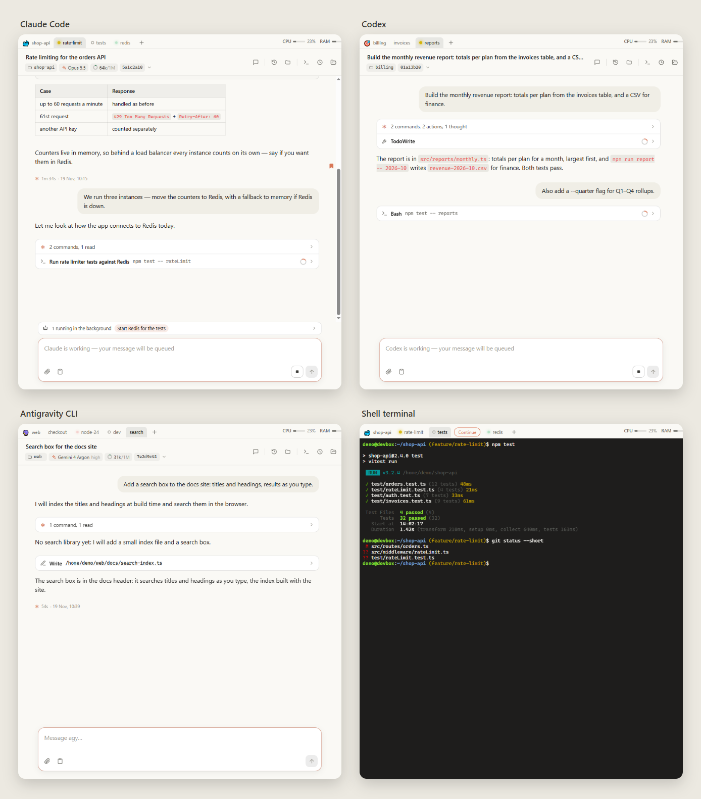
      <sub><b>Claude Code, Codex, Antigravity CLI и терминал</b> в одном воркспейсе.</sub>
    </td>
    <td width="50%" valign="top">
      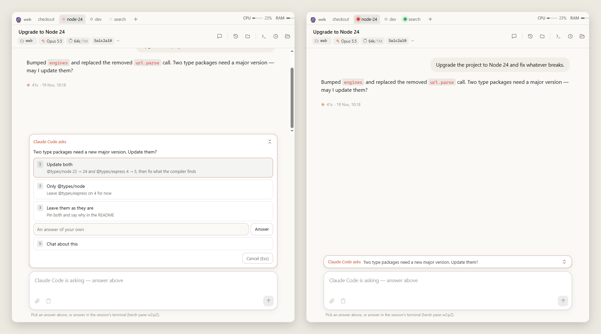
      <sub><b>Интерактивные вопросы агента</b> кнопками над полем ввода (в развёрнутом и свёрнутом виде).</sub>
    </td>
  </tr>
</table>

---

### 2. Воркспейсы `herdr`, лампы статуса и шкалы лимитов

- **Воркспейсы, вкладки и форк диалогов** — слева расположены воркспейсы и список сессий, сверху над диалогом — вкладки текущего воркспейса. Перетаскивайте вкладки, переименовывайте (`F2`), меняйте иконки, переключайтесь по `Ctrl+Tab` или дублируйте вкладку вместе с форком диалога (`claude --resume <id> --fork-session` / `codex fork <id>`).
- **Лампы состояния и напоминания** — по цвету индикатора сразу видно, где агент работает, где ждёт ответа, а где закончил с непрочитанным сообщением. Кнопка с часами или `Ctrl+Q` оставляет гореть синюю лампу-напоминание на всех устройствах, пока вы не вернётесь к задаче.
- **Скрытие и восстановление сессий** — временно ненужные воркспейсы можно скрыть иконкой перечёркнутого глаза (они сами появятся снова, когда агент закончит или задаст вопрос). Закрытые вкладки `herdr` возвращаются со всей историей кнопкой **Restore**, а после перезагрузки ПК кнопка **Continue** в один клик возобновляет диалог.
- **Лимиты и нагрузка системы перед глазами** — в шапке боковой панели видны шкалы расхода за 5 часов и за неделю для **Claude**, **Codex / ChatGPT** и **Antigravity CLI (`agy`)**, а в правом верхнем углу — живая загрузка **CPU**, **RAM** и **GPU** (по клику открывается список самых тяжёлых процессов).

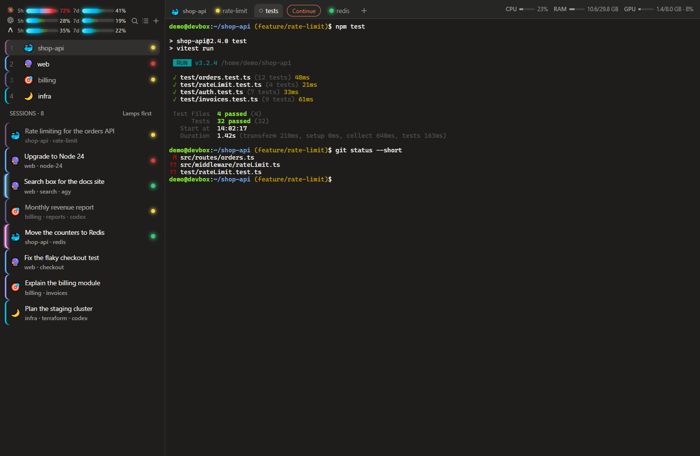

---

### 3. Файлы проекта, документы, Столы (`Desks`) и диффы всей ветки

- **Встроенный просмотр файлов и документов** — клик по любому пути в ответе (`/src/app.ts:42`, `~/notes.md`, `C:\repo\a.cs:10-20`) открывает файл сразу на нужной строке в правой панели:
  - **Исходный код, CSV и картинки** — с подсветкой синтаксиса, переходом к строке и быстрой правкой на месте (`✎`, `Ctrl+S`);
  - **Markdown и HTML** — вёрстка с таблицами, масштабируемыми **диаграммами Mermaid** и изолированным предпросмотром HTML-страниц;
  - **PDF и DOCX** — постраничное отображение документов Word и PDF с выделением текста.
- **Столы (`Desks`) и открытие в локальной IDE** — важные спеки, схемы, PDF или `README` можно закрепить за рабочим **Столом** проекта (`.desks/<имя>.json`) или за сессией. За тем же ПК любой файл открывается на нужной строке в VS Code, Rider / JetBrains IDE, Sublime, Notepad++ или браузерном VS Code (`--vscode`).
- **Дифф по всей ветке (`Branch changes`)** — показывает все изменения текущей Git-ветки с момента её создания (все коммиты, незакоммиченные правки и новые файлы вместе) относительно базовой ветки.

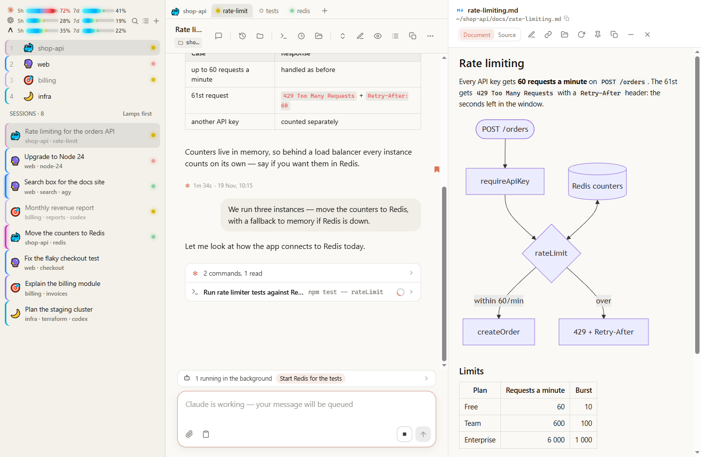

<table>
  <tr>
    <td width="50%" valign="top">
      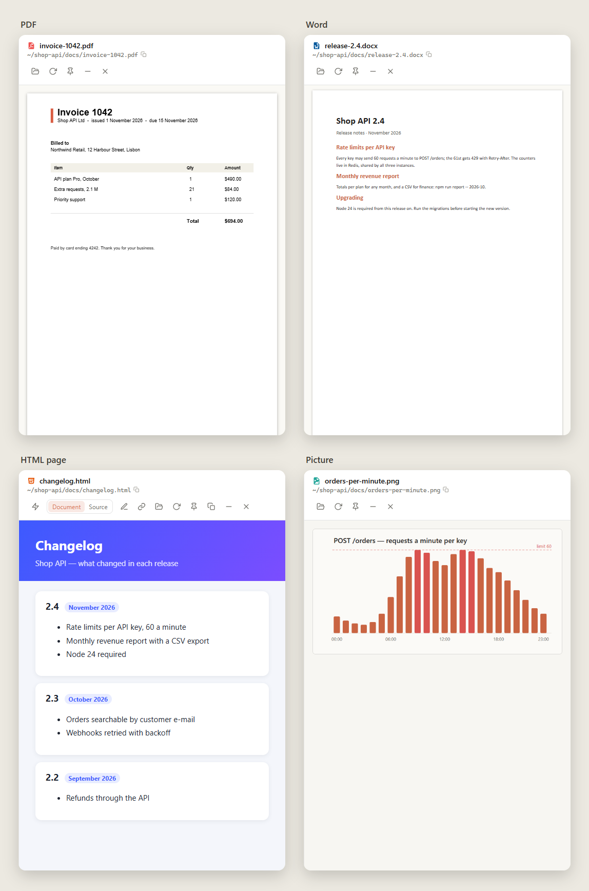
      <sub><b>Встроенный просмотр</b> PDF, Word, HTML-отчётов и графиков.</sub>
    </td>
    <td width="50%" valign="top">
      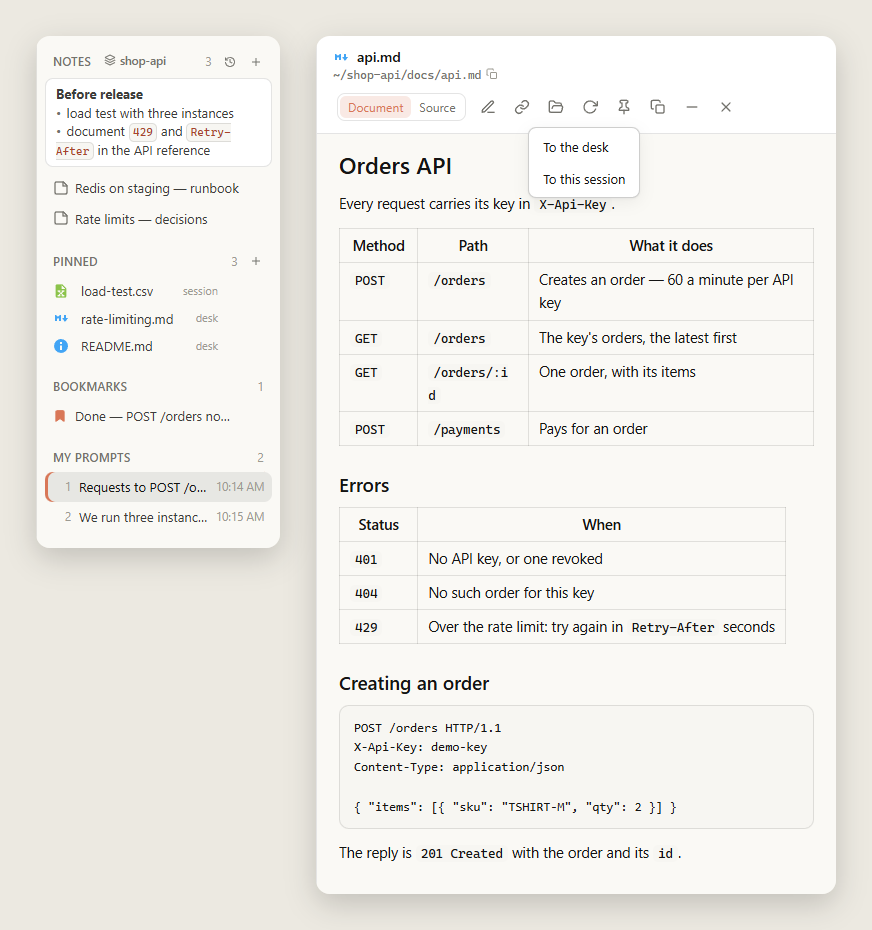
      <sub><b>Столы проекта (Desks):</b> закреплённые спеки, файлы и заметки в Outline.</sub>
    </td>
  </tr>
</table>

---

### 4. Два Markdown-редактора, история заметок и навигация по запросам

- **Два режима редактирования Markdown (`T`)** — переключайте заметки и `.md`-файлы между **живым предпросмотром в стиле Obsidian** (CodeMirror, разметка видна только на активной строке) и **блочным редактором в стиле Notion** (Milkdown Crepe с меню `/` и перетаскиванием блоков).
- **История заметок на 200 шагов** — заметки сохраняются автоматически, выгружаются в файл (`⤓`) и ведут журнал последних 200 изменений (**Notes history**) с восстановлением в один клик.
- **Оглавление по промптам, закладки и копирование в Markdown** — прыгайте между своими запросами в длинных сессиях (`Alt+↑` / `Alt+↓`), отмечайте важные ответы синхронизируемыми **закладками**, а по `Ctrl+C` копируйте любой выделенный фрагмент ответа сразу в чистый Markdown с сохранением таблиц, ссылок и блоков кода.
- **Отложенные промпты «на потом» (`Alt+Enter`)** — сохраняйте идеи для следующего шага в общий список над полем ввода, пока агент ещё работает, не отправляя их в автоочередь терминала.

<table>
  <tr>
    <td width="50%" valign="top">
      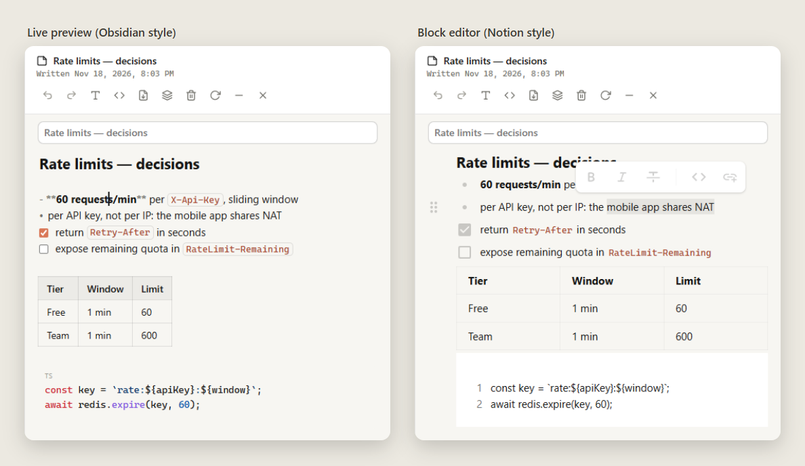
      <sub><b>Два редактора Markdown:</b> живой предпросмотр Obsidian и блочный редактор Notion.</sub>
    </td>
    <td width="50%" valign="top">
      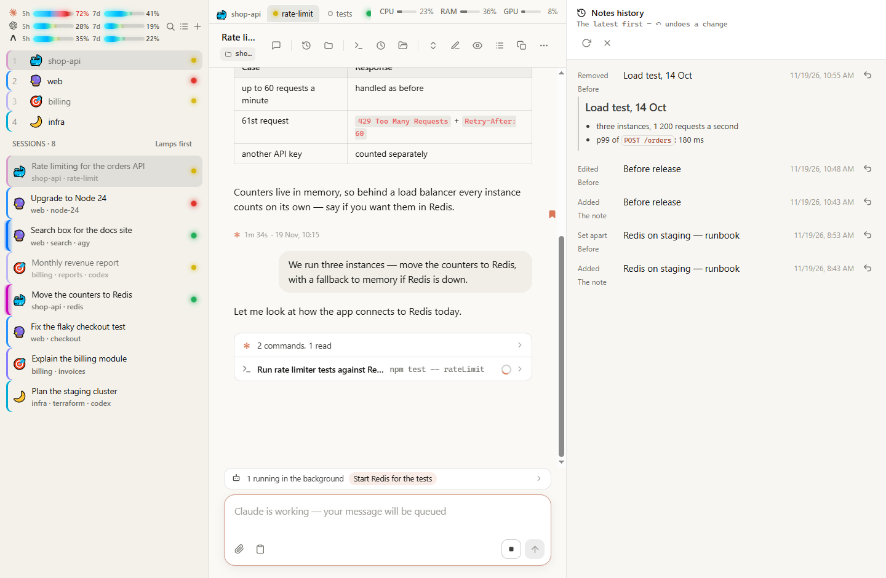
      <sub><b>Notes history:</b> журнал на 200 версий с восстановлением в один клик.</sub>
    </td>
  </tr>
</table>

---

### 5. Удалённая работа и мобильный интерфейс

- **Дерево проекта, загрузка и скачивание папок `.zip`-архивом** — ищите по коду регулярными выражениями, загружайте файлы в любую папку проекта (с разрешением конфликтов `Replace`, `Rename`, `Skip`) и скачивайте отдельные файлы (с докачкой) или целые папки потоковым `.zip`-архивом на лету (до 2 ГБ, без `.git`).
- **Адаптация под экран телефона** — свайпы от краёв экрана открывают воркспейсы, оглавление и последний документ; открытые файлы сворачиваются карточками над полем ввода; у мобильного терминала есть панель клавиш (`Esc`, `Tab`, стрелки, `Enter`, `Ctrl+C`, вставка).
- **Быстрая загрузка сессий на 100+ МБ и офлайн-режим** — сначала подгружается хвост диалога, а Service Worker кеширует интерфейс и недавние сессии для чтения и постановки промптов в очередь даже без сети.

<table>
  <tr>
    <td width="50%" valign="top">
      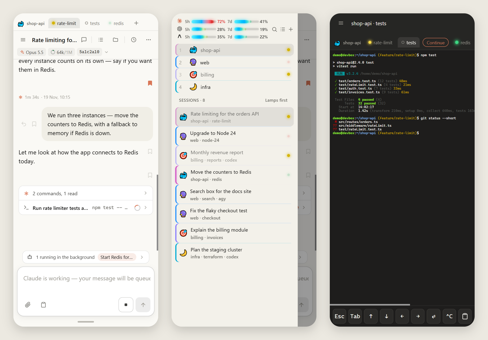
      <sub><b>Мобильная версия:</b> сессия, панель воркспейсов herdr и терминал с клавишами.</sub>
    </td>
    <td width="50%" valign="top">
      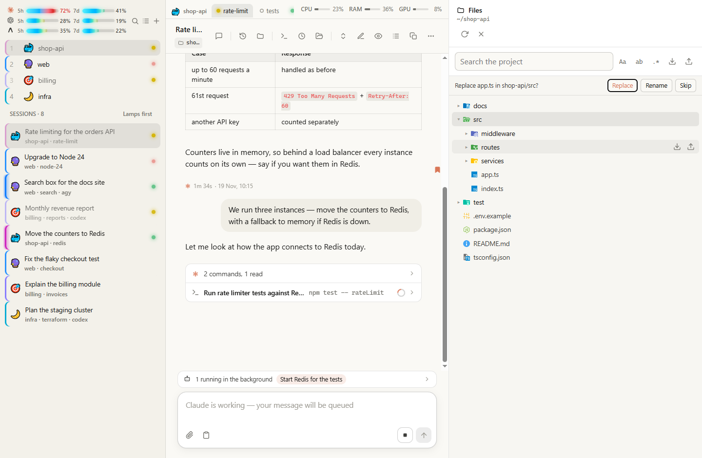
      <sub><b>Файловый менеджер:</b> поиск по проекту, закачка и выгрузка папок в <code>.zip</code>.</sub>
    </td>
  </tr>
</table>

---

## Настройка и параметры CLI

<details>
<summary><strong>Удалённый доступ через Cloudflare Tunnel и Access (5 шагов)</strong></summary>

<br>

Для доступа с телефона или другого компьютера не нужен ни арендованный VPS, ни проброс портов на роутере — достаточно бесплатного тарифа Cloudflare Zero Trust и домена в Cloudflare:

1. **Создайте туннель** — в панели Cloudflare откройте **Networking → Tunnels → Create a tunnel** и установите службу `cloudflared` на компьютер.
2. **Добавьте маршрут** — в **Routes → Add route → Published application** направьте поддомен (например, `viewer.example.com`) на `http://localhost:7788`.
3. **Закройте вход через Cloudflare Access (обязательно)** — в **Zero Trust → Access controls → Applications → Create new application → Self-hosted** добавьте приложение для `viewer.example.com` с политикой **Allow** только для вашего email (одноразовый PIN, Google или GitHub). *Не пропускайте этот шаг: в сессиях есть секреты, а `herdr` даёт доступ к терминалу.*
4. **Включите проверку токена в туннеле** — в настройках маршрута включите [Protect with Access](https://developers.cloudflare.com/cloudflare-one/networks/connectors/cloudflare-tunnel/configure-tunnels/origin-parameters/), чтобы `cloudflared` отклонял запросы без токена Access.
5. **Запустите просмотрщик с `--public-url`**:
   ```bash
   node bin/claude-code-webview.js --background --public-url https://viewer.example.com
   ```
   Сервер отвечает только на `127.0.0.1` и явно указанные `--public-url`.

На iPhone добавьте страницу на экран «Домой» (Safari: «Поделиться» → «На экран „Домой“») для иконки в выбранной палитре (`--palette`) и постоянного офлайн-хранилища.

</details>

<details>
<summary><strong>Настройка лимитов и режима <code>ccproxy</code> (Claude GPT)</strong></summary>

<br>

#### Свежие данные о лимитах Claude, Codex и Antigravity CLI

- **Claude** — по умолчанию лимиты читаются из `~/.claude.json`. Чтобы видеть актуальные цифры после каждого ответа, добавьте в свою команду `statusline` сохранение `rate_limits`:
  ```bash
  input=$(cat); echo "$input" | jq -c '.rate_limits // empty' > ~/.claude-code-webview/rate-limits.json
  ```
- **ChatGPT / Codex** — лимиты Codex подхватываются автоматически; для GPT-шлюза можно передать путь к снимку квоты через `--chatgpt-usage-file <путь>`.
- **Antigravity CLI (`agy`)** — сохраняйте `{ "model": ..., "quota": ... }` из stdin команды `statusLine` в `~/.claude-code-webview/agy-statusline.json`, чтобы в шапке появилась третья строка лимитов.
- **Модель и контекст сессии** — statusline может писать метаданные активной сессии в `~/.claude-code-webview/session-status/<session-uuid>.json` (`{ "at": <мс>, "model": "<id>", "contextTokens": 64000, "contextWindow": 1000000, "effort": "high" }`).

#### Запуск через `ccproxy` (`Claude GPT`)

```bash
node bin/claude-code-webview.js --claude-gpt-command my-claude-gpt
```

При создании вкладки или воркспейса появится выбор между **Claude Code** и **Claude GPT**, а в шапке активной сессии — кнопка **Restart in Claude GPT** / **Restart in Claude Code** для переключения на лету.

</details>

<details>
<summary><strong>Все параметры командной строки и пути к данным</strong></summary>

<br>

| Параметр | Что делает |
| --- | --- |
| *(без параметров)* | Запустить сервер на `127.0.0.1:7788` и открыть браузер (`Ctrl+C` останавливает) |
| `--background`, `-b` | Запустить в фоне без окна терминала (лог: `~/.claude-code-webview/server.log`) |
| `--stop` / `--restart` | Остановить или перезапустить фоновый просмотрщик |
| `--port <порт>`, `-p` | Порт на `127.0.0.1` (по умолчанию `7788`) |
| `--palette <имя>` | Цветовая палитра интерфейса и иконки: `clay` (по умолчанию), `sea`, `moss`, `plum` |
| `--public-url <url>` | Разрешить работу по публичному адресу за туннелем (можно указать несколько раз) |
| `--no-open` | Не открывать браузер при старте |
| `--no-herdr` | Только чтение сессий: не использовать `herdr`, даже если он запущен |
| `--claude-command <команда>` | Команда запуска Claude Code в новых вкладках (по умолчанию `claude`) |
| `--claude-gpt-command <команда>` | Команда запуска Claude Code через GPT-шлюз (**Claude GPT**) |
| `--chatgpt-usage-file <путь>` | Путь к JSON-снимку лимитов ChatGPT от statusline шлюза |
| `--codex-command <команда>` | Команда запуска и возобновления Codex (по умолчанию `codex`) |
| `--agy-command <команда>` | Команда запуска и возобновления Antigravity CLI (по умолчанию `agy`) |
| `--restart-env <ИМЯ=ЗНАЧЕНИЕ>` | Переменная окружения для перезапуска сессии из интерфейса |
| `--editor-command <команда>` | Команда открытия файла в локальном редакторе (`{path}`, `{line}`, `{project}`) |
| `--vscode <программа>` | Поднять браузерный VS Code (`code serve-web`) на `/vscode/` и открывать локальный VS Code за тем же ПК |
| `--install-shortcut` | Windows: создать ярлык на рабочем столе (`--start-menu` — в меню «Пуск») |

**Где хранятся данные агентов:**
- **Claude Code:** `~/.claude/projects` (или `$CLAUDE_CONFIG_DIR/projects`), включая транскрипты субагентов.
- **Codex:** `~/.codex/sessions` (или `$CODEX_HOME/sessions`), `thread-writer-locks/` и `session_index.jsonl`.
- **Antigravity CLI:** `~/.gemini/antigravity-cli` (транскрипты в `brain/<id>/.system_generated/logs/`, заголовки в `conversation_summaries.db` и логи в `log/`).

</details>

<details>
<summary><strong>Как это устроено, безопасность и разработка</strong></summary>

<br>

```text
Транскрипт агента (.jsonl)  ──(проверка каждые 400 мс, чтение только новых байт)──►  SSE /api/stream  ──►  DOM
Ввод со страницы            ──(Origin + X-Viewer, вызов herdr напрямую без shell)──►  панель herdr
```

- **Защита от внешних сайтов** — сервер слушает только `127.0.0.1`, проверяет `Host` (защита от DNS rebinding), а все пишущие запросы требуют свой `Origin` и заголовок `X-Viewer`.
- **Безопасный рендеринг** — весь Markdown проходит через DOMPurify; HTML-документы открываются в изолированном `iframe`-песочнице без выхода выше своей папки (`..`).
- **Атомарная запись и вызов без shell** — `herdr` вызывается напрямую без командной оболочки; загружаемые файлы пишутся во временный файл рядом и заменяют целевой атомарно.

#### Разработка

```bash
npm install                      # установка dev-зависимостей (TypeScript, jsdom)
npm start                        # запуск из рабочей копии
npm test                         # тесты (node:test)
npm run check                    # проверка типов через TypeScript и JSDoc
node scripts/build-milkdown.mjs  # пересборка бандла public/lib/milkdown
```

</details>

## Лицензия

[MIT](LICENSE)
