# Claude Code Webview

[English version](README.md)

Веб-интерфейс для работы с **[Claude Code](https://code.claude.com)**, **Codex**, **Antigravity CLI (`agy`)** и обычной **командной строкой** поверх воркспейсов **[herdr](https://herdr.dev)**.

Он заменяет разрозненные окна терминала одним удобным приложением в браузере: со списком проектов и вкладок, чтением документов и диффов рядом с диалогом, заметками, закладками и контролем лимитов. В нём одинаково удобно работать за большим монитором, с ноутбука в поездке или с телефона — в том числе удалённо через Cloudflare.

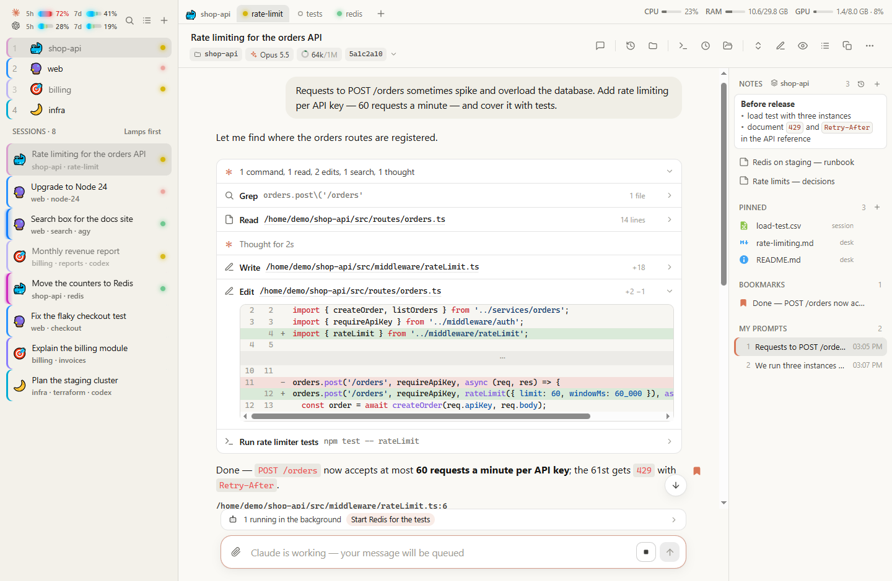

---

## Что внутри

### Claude Code, Codex, Antigravity CLI и терминал в одном окне

Вместо того чтобы переключаться между разными программами и окнами терминала, вы ведёте все сессии в одном месте:

- **Три агента рядом** — поддерживаются **Claude Code**, **Codex** и **Antigravity CLI (`agy`)**. Для каждого показываются промпты, отформатированные ответы, время размышлений, вызовы инструментов (`Bash`, `Read`, `Edit`, `Write`, субагенты) с диффами и выводом. Длинные цепочки вызовов по умолчанию свёрнуты в одну компактную строку (`4 commands, 1 read, 6 edits`), но при желании раскрываются целиком.
- **Живое управление сессией** — пишите промпты прямо со страницы, прикрепляйте или вставляйте из буфера скриншоты, пользуйтесь автодополнением слеш-команд (`/`), задавайте быстрые вопросы без записи в историю (`/btw`), откатывайте диалог и код (`/rewind`), меняйте модель (`/model`) и проверяйте серверы `/mcp`.
- **Интерактивные вопросы поверх поля ввода** — когда агент в терминале ждёт выбора варианта или подтверждения (`AskUserQuestion`, доверие к папке, разрешение на команду), варианты появляются обычными кнопками над полем ввода. Карточку вопроса можно свернуть в одну строку, чтобы спокойно перечитать диалог.
- **Переключение между Claude Code и `ccproxy` (`Claude GPT`)** — если подключить обёртку для работы через GPT-прокси (`--claude-gpt-command`), новые вкладки можно запускать как в обычном Claude Code, так и в режиме **Claude GPT**, а уже идущую сессию — на лету перезапускать из одного режима в другой без потери истории.
- **Обычная командная строка** — любая вкладка `herdr`, где открыт shell, `nvim`, тесты или `htop`, работает прямо в браузере как живой терминал (`xterm.js`).

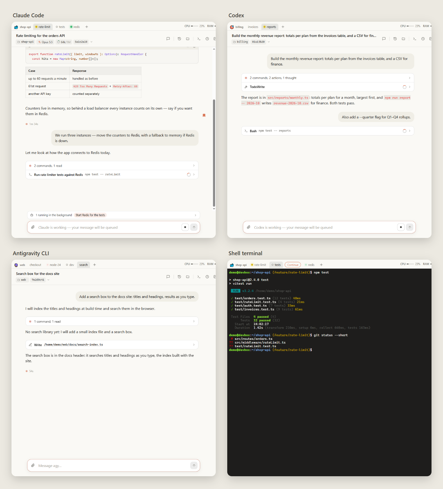

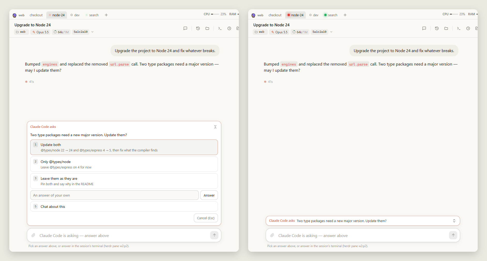

---

### Удобство `herdr`, но в современном интерфейсе

Если ваши сессии запущены внутри [herdr](https://herdr.dev), веб-интерфейс полностью повторяет его структуру воркспейсов и вкладок, добавляя к ней привычные возможности настольного приложения:

- **Воркспейсы и вкладки** — слева расположены ваши воркспейсы и список всех сессий, сверху над диалогом — вкладки текущего воркспейса. Вкладки можно перетаскивать мышью, переименовывать (`F2`), снабжать иконками, закрывать или **дублировать вместе с форком диалога** (`claude --resume <id> --fork-session` или `codex fork <id>`). Между последними открытыми вкладками работает быстрое переключение по **`Ctrl+Tab`**.
- **Лампы состояния и напоминания** — по цвету индикатора сразу видно, где агент работает, где ждёт вашего ответа, а где уже закончил и ответ ещё не прочитан. Если вы открыли готовый ответ, но хотите вернуться к задаче позже, нажмите кнопку с часами или **`Ctrl+Q`** — синяя лампа останется гореть на всех устройствах, пока вы сами её не снимете.
- **Скрытие неактивных задач без закрытия** — временно ненужные воркспейсы и вкладки можно убрать из списка иконкой перечёркнутого глаза, не останавливая сами процессы. Как только агент внутри закончит работу или задаст вопрос, воркспейс сам появится снова.
- **История и восстановление закрытых сессий** — кнопка истории над сессией показывает все прошлые разговоры текущей вкладки и список **закрытых вкладок `herdr`**. Любую закрытую вкладку можно открыть для чтения или вернуть обратно в воркспейс кнопкой **Restore**. А после перезагрузки компьютера кнопка **Continue** в один клик возобновит в пустой вкладке ровно тот диалог, который шёл в ней раньше.
- **Лимиты и нагрузка системы всегда перед глазами** — в шапке боковой панели отображаются шкалы расхода за 5 часов и за неделю сразу для **Claude** и для **ChatGPT / Codex** (зелёный запас, когда вы укладываетесь по времени, и красная отметка при перерасходе). В правом верхнем углу видны загрузка **CPU**, **RAM** и **GPU** — по клику открывается живой список самых тяжёлых процессов.

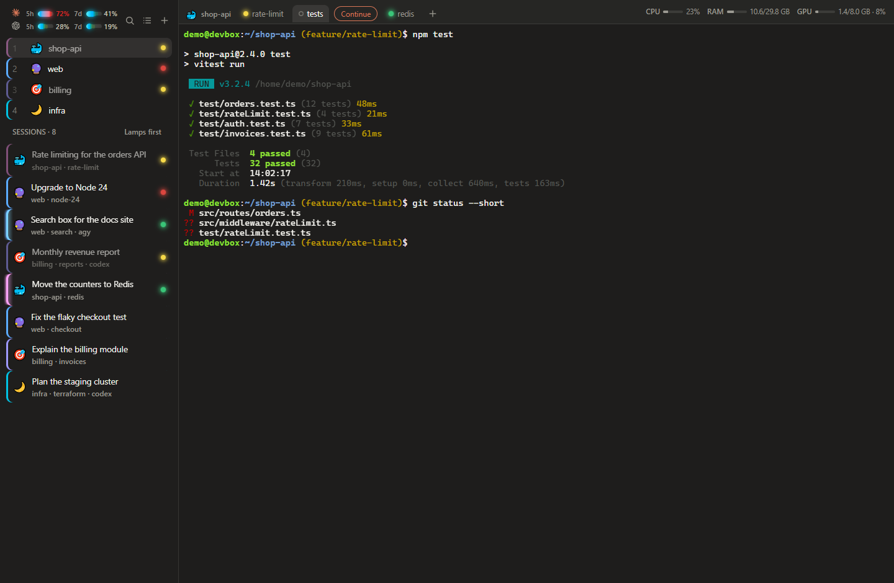

---

### Файлы, документы и диффы по всей ветке прямо во время работы

Не нужно переключаться в редактор или файловый менеджер, чтобы посмотреть файл, о котором пишет агент, или проверить, что изменилось в проекте:

- **Просмотр основных типов файлов** — любой путь в ответе (`/Users/ann/app/src/x.ts:42`, `~/notes.md`, `C:\repo\a.cs:10-20`) или в вызове инструмента по клику открывается в правой боковой панели. Поддерживаются:
  - **Markdown** — с картинками, таблицами, подсветкой кода и **диаграммами Mermaid** (с масштабированием по клику);
  - **HTML** — рендерится в изолированной песочнице вместе со стилями и картинками рядом (скрипты по умолчанию выключены и запускаются кнопкой `⚡` в отдельном origin);
  - **DOCX и PDF** — аккуратная постраничная вёрстка документов Word и PDF (с выделением текста через `pdf.js`);
  - **Картинки, CSV-таблицы и исходный код** — с подсветкой синтаксиса, переходом к нужной строке и быстрой правкой текстовых файлов прямо на странице (`✎`, `Ctrl+S`).
- **Столы (`Desks`) и закреплённые файлы** — важные для задачи файлы (ТЗ, схемы, документацию, `README`) и заметки можно закрепить за рабочим **Столом** проекта (`.desks/<имя>.json`) или за конкретной сессией. Они всегда остаются под рукой в правой колонке во всех сессиях этого воркспейса. При работе за тем же компьютером любой файл можно в один клик открыть в вашей локальной IDE (VS Code, Rider и другие JetBrains IDE, Sublime, Notepad++) или в браузерном **VS Code** (`--vscode`).
- **Диффы по всей работе в ветке (`Branch changes`)** — кнопка над сессией показывает не отдельный коммит, а все изменения текущей Git-ветки с момента её создания: все коммиты ветки, незакоммиченные правки и новые файлы относительно базовой ветки (при желании базовую ветку можно сменить в один клик).

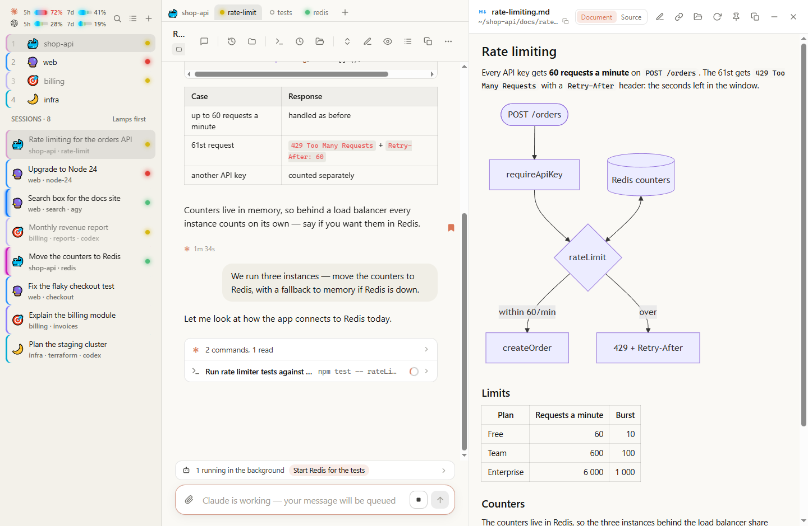

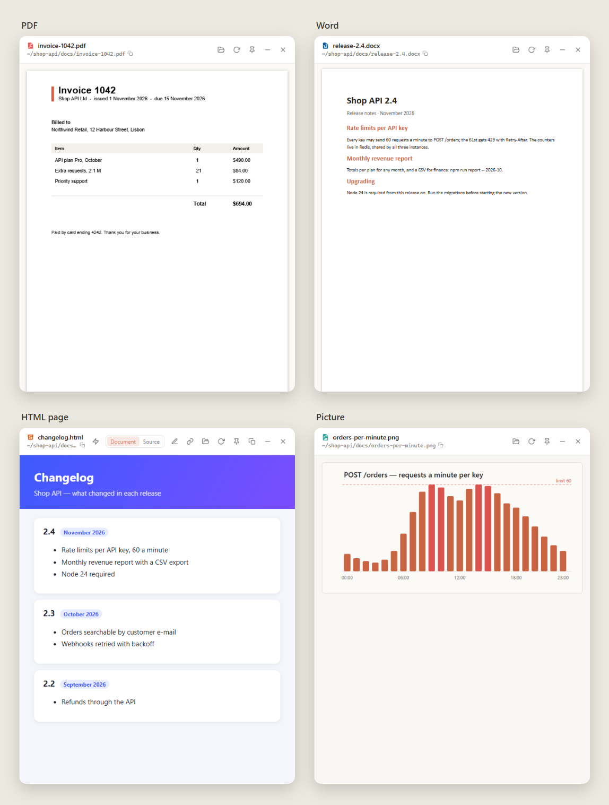

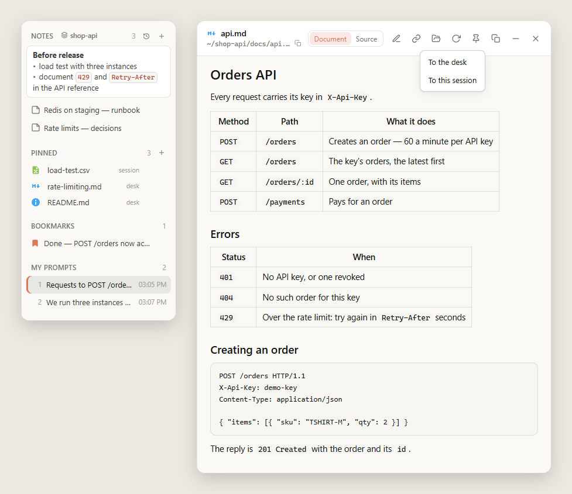

---

### Два Markdown-редактора, заметки и навигация по своим запросам

Рабочие записи, чеклисты и `.md`-файлы проекта редактируются прямо рядом с сессией:

- **Два редактора на выбор** — переключайтесь кнопкой **`T`** (или через меню `⋯`) между двумя режимами:
  - **Живой предпросмотр в стиле Obsidian** (CodeMirror) — заголовки, списки, чекбоксы `[ ]`, редактируемые таблицы и блоки кода выглядят как готовый документ, а разметка Markdown видна только на той строке, где стоит курсор (кнопка `</>` показывает чистый исходник);
  - **Блочный редактор в стиле Notion** (Milkdown Crepe) — вставка блоков через `/`, перетаскивание за боковую ручку слева и всплывающая панель форматирования над выделенным текстом.
- **История изменений заметок** — заметки сохраняются автоматически по мере ввода, поддерживают `Ctrl+Z` / `Ctrl+Shift+Z`, выгружаются в обычный файл кнопкой `⤓` и хранят журнал последних 200 изменений (**Notes history**): любую случайную правку или удалённую заметку можно вернуть одним нажатием.
- **Закладки и переход между своими запросами** — правое оглавление (**Outline**) собирает все ваши промпты в сессии (между ними удобно прыгать по **`Alt+↑`** и **`Alt+↓`**). Любой важный ответ или отчёт субагента можно отметить флажком **закладки** — закладки синхронизируются между всеми вашими устройствами.
- **Копирование части текста в Markdown** — если выделить любой фрагмент ответа и нажать `Ctrl+C`, в буфер обмена скопируется чистый Markdown с сохранением структуры (заголовки, списки, ссылки, таблицы, блоки кода с языком) и одновременно готовое форматирование для вставки в документы.
- **Отложенные промпты «на потом» (`Alt+Enter`)** — если во время работы агента появилась идея для следующего шага, но вы не хотите ставить её в автоочередь терминала, нажмите часы рядом с кнопкой отправки (`Alt+Enter`). Запрос сохранится в список над полем ввода (доступный и с ПК, и с телефона), откуда его можно отредактировать или отправить в нужный момент.

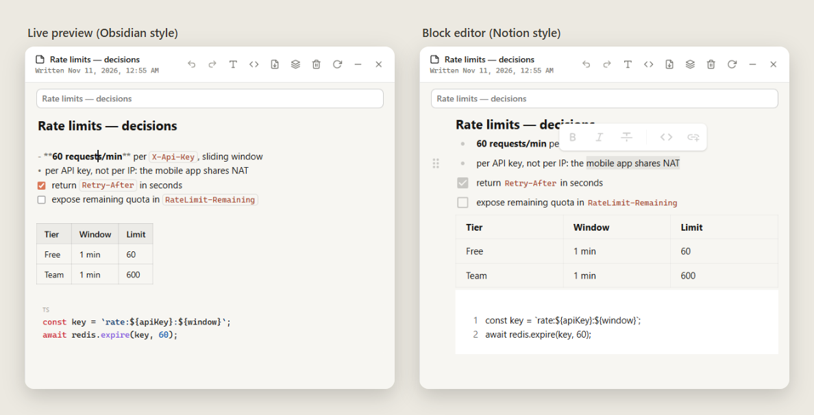

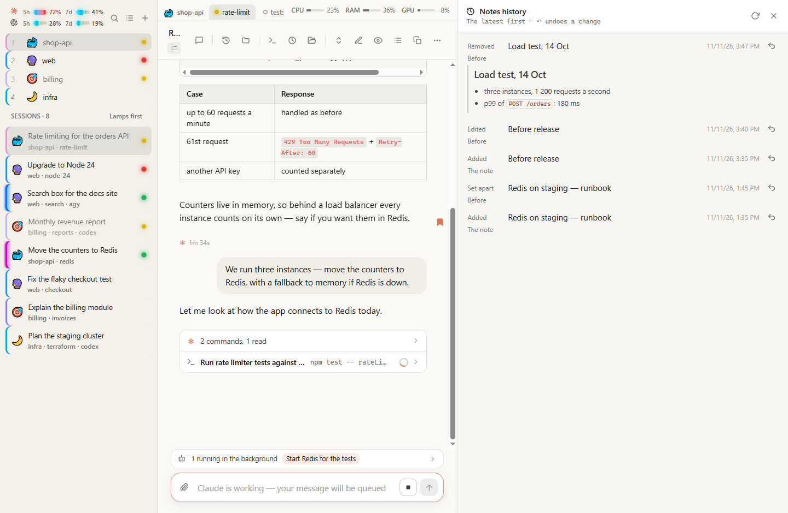

---

### Удалённая работа через Cloudflare и полная поддержка мобильного экрана

По умолчанию сервер слушает только локальный `127.0.0.1`. Но если поднять перед ним **Cloudflare Tunnel** и **Cloudflare Access** (`--public-url`), вы получаете защищённый доступ к своему рабочему окружению из любого браузера и с телефона:

- **Дерево проекта, скачивание и закачка файлов** — просматривайте файлы проекта, ищите по коду (с регулярными выражениями), **скачивайте отдельные файлы** (с докачкой при обрыве связи) **или целые папки `.zip`-архивом на лету** (до 2 ГБ, без `.git`) и **закачивайте файлы обратно** в любую папку проекта с разрешением конфликтов имён (`Replace`, `Rename`, `Skip`).
- **Полноценный мобильный интерфейс**:
  - свайп от левого края открывает список воркспейсов и сессий, свайп от правого края — оглавление с заметками, закладками и файлами, а повторный свайп влево возвращает последний открытый документ;
  - файлы и заметки открываются удобным нижним листом: потяните его вниз — и документ свернётся компактной карточкой над полем ввода, чтобы можно было держать открытыми сразу несколько файлов и переключаться между ними в одно касание;
  - под терминалом на телефоне есть ряд недостающих клавиш (**`Esc`**, **`Tab`**, стрелки, **`Enter`**, **`Ctrl+C`**, вставка из буфера), а скрепка в поле ввода позволяет прикрепить фото прямо с камеры или из галереи.
- **Быстрая загрузка и офлайн-режим** — огромные сессии на 100+ МБ открываются за секунду за счёт подгрузки хвоста диалога и ленивого чтения больших выводов. Service Worker сохраняет интерфейс и недавние сессии в браузере: даже без сети или при выключенном компьютере вы можете перечитывать диалоги и писать промпты в очередь — они отправятся автоматически, когда связь появится.

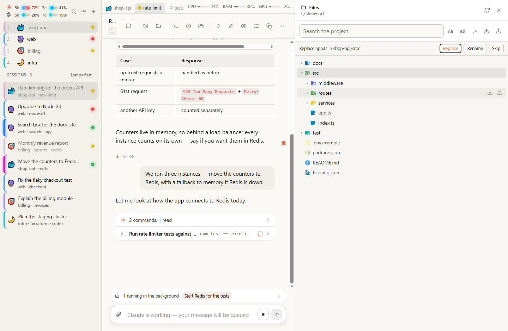

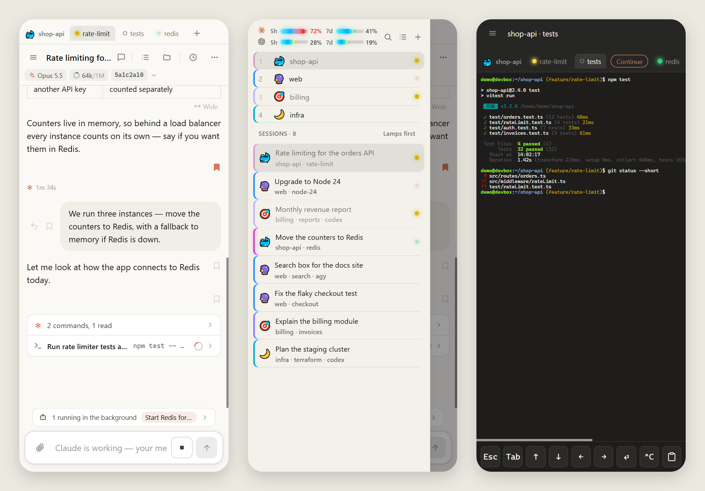

---

## Быстрый старт

Для запуска нужен **Node.js 22** или новее. Сборка не требуется — приложение работает прямо из исходников:

```bash
git clone https://github.com/andrew-mart/claude-code-webview.git
cd claude-code-webview
npm install --omit=dev
node bin/claude-code-webview.js
```

Откроется адрес `http://127.0.0.1:7788`. Если сервер уже запущен, команда просто откроет вкладку браузера.

- **Фоновый режим** (без окна терминала): `node bin/claude-code-webview.js --background`
- **Остановка / перезапуск**: `node bin/claude-code-webview.js --stop` и `node bin/claude-code-webview.js --restart`
- **Связка с `herdr`**: один раз запустите просмотрщик из панели [herdr](https://herdr.dev) — он запомнит путь к сокету и бинарнику в `~/.claude-code-webview/herdr.json` и дальше сможет запускаться откуда угодно (например, с ярлыка на рабочем столе). Без `herdr` всё остальное — чтение сессий, документы, заметки, диффы и закладки — работает как обычно.

*Интерфейс самой страницы — на английском языке.*

---

## Удалённый доступ через Cloudflare

Для доступа с телефона или другого компьютера не нужен ни арендованный сервер, ни проброс портов на роутере — достаточно бесплатного тарифа Cloudflare Zero Trust и домена в Cloudflare:

1. **Создайте туннель** — в панели Cloudflare откройте **Networking → Tunnels → Create a tunnel** и установите службу `cloudflared` на компьютер по инструкции из панели.
2. **Добавьте маршрут** — в настройках туннеля (**Routes → Add route → Published application**) направьте поддомен (например, `viewer.example.com`) на `http://localhost:7788`.
3. **Закройте вход через Cloudflare Access (обязательно)** — в **Zero Trust → Access controls → Applications → Create new application → Self-hosted** добавьте приложение для `viewer.example.com` с политикой **Allow** только для вашего email (вход по одноразовому коду с почты, через Google или GitHub). *Не пропускайте этот шаг: в сессиях есть секреты, а `herdr` даёт доступ к терминалу.*
4. **Включите проверку токена в самом туннеле** — в настройках маршрута включите [Protect with Access](https://developers.cloudflare.com/cloudflare-one/networks/connectors/cloudflare-tunnel/configure-tunnels/origin-parameters/), чтобы `cloudflared` не пропускал запросы без валидного токена Access.
5. **Запустите просмотрщик с `--public-url`**:
   ```bash
   node bin/claude-code-webview.js --background --public-url https://viewer.example.com
   ```
   Сервер отвечает только на `127.0.0.1` и явно перечисленные `--public-url`, отклоняя любые чужие заголовки `Host` и `Origin`.

На iPhone удобно добавить страницу на экран «Домой» (в Safari: «Поделиться» → «На экран „Домой“») — так она получит собственную иконку в выбранной цветовой палитре (`--palette`) и постоянное хранилище для офлайн-режима.

---

## Настройка лимитов и режима `ccproxy` (`Claude GPT`)

### Свежие данные о лимитах Claude и ChatGPT / Codex

- **Claude** — по умолчанию лимиты читаются из `~/.claude.json`, но Claude Code обновляет их там нечасто. Чтобы видеть актуальные цифры после каждого ответа, добавьте в свою команду `statusline` сохранение поля `rate_limits` в `~/.claude-code-webview/rate-limits.json`:
  ```bash
  input=$(cat); echo "$input" | jq -c '.rate_limits // empty' > ~/.claude-code-webview/rate-limits.json
  ```
- **ChatGPT / Codex** — лимиты Codex подхватываются автоматически, а при использовании GPT-шлюза можно дополнительно передать путь к файлу со снимком квоты через `--chatgpt-usage-file <путь>` (JSON вида `{ "at": <мс>, "status": 200, "limits": { "five_hour": { "used_percentage": 28, "resets_at": <сек> }, "seven_day": { ... } } }`).
- **Модель и контекст от внешнего шлюза** — statusline шлюза может писать текущую модель, размер окна и расход токенов в `~/.claude-code-webview/session-status/<session-uuid>.json` (`{ "at": <мс>, "model": "<id>", "contextTokens": 64000, "contextWindow": 1000000, "effort": "high" }`).

### Запуск через `ccproxy` (`Claude GPT`)

Чтобы держать обычный Claude Code и запуск через GPT-шлюз параллельно, укажите команду запуска шлюза:

```bash
node bin/claude-code-webview.js --claude-gpt-command my-claude-gpt
```

При создании новой вкладки или воркспейса появится выбор между **Claude Code** и **Claude GPT**, а в подробностях шапки любой активной сессии — кнопка **Restart in Claude GPT** / **Restart in Claude Code** для переключения режима на лету.

---

## Параметры командной строки

| Параметр | Что делает |
| --- | --- |
| *(без параметров)* | Запустить сервер на `127.0.0.1:7788` и открыть браузер (`Ctrl+C` останавливает) |
| `--background`, `-b` | Запустить в фоне без окна терминала (лог: `~/.claude-code-webview/server.log`) |
| `--stop` | Остановить запущенный просмотрщик |
| `--restart` | Перезапустить просмотрщик в фоне |
| `--port <порт>`, `-p` | Порт на `127.0.0.1` (по умолчанию `7788`) |
| `--palette <имя>` | Цветовая палитра интерфейса и иконки: `clay` (по умолчанию), `sea`, `moss`, `plum` |
| `--public-url <url>` | Разрешить работу по публичному адресу за туннелем (можно указать несколько раз) |
| `--no-open` | Не открывать браузер при старте |
| `--no-herdr` | Только чтение сессий: не использовать `herdr`, даже если он запущен |
| `--claude-command <команда>` | Команда запуска Claude Code в новых вкладках (по умолчанию `claude`) |
| `--claude-gpt-command <команда>` | Команда запуска Claude Code через GPT-шлюз (**Claude GPT**) |
| `--chatgpt-usage-file <путь>` | Путь к JSON-снимку лимитов ChatGPT от statusline шлюза |
| `--codex-command <команда>` | Команда запуска и возобновления Codex (по умолчанию `codex`, например `"codex --full-auto"`) |
| `--agy-command <команда>` | Команда запуска и возобновления Antigravity CLI (по умолчанию `agy`) |
| `--restart-env <ИМЯ=ЗНАЧЕНИЕ>` | Переменная окружения для перезапуска сессии из интерфейса (например, `CLAUDE_CODE_DISABLE_BG_SHELL_PRESSURE_REAP=1`) |
| `--editor-command <команда>` | Команда открытия файла в локальном редакторе (`{path}`, `{line}`, `{project}`; в Windows по умолчанию работает ассоциация файлов Проводника) |
| `--vscode <программа>` | Поднять браузерный VS Code (`code serve-web`) на `/vscode/` и открывать локальный VS Code за тем же ПК (`code-tunnel.exe` в Windows, `code` в других ОС) |
| `--install-shortcut` | Windows: создать ярлык на рабочем столе (`--start-menu` — в меню «Пуск») |

**Где хранятся данные агентов:**
- **Claude Code:** `~/.claude/projects` (или `$CLAUDE_CONFIG_DIR/projects`), включая транскрипты субагентов.
- **Codex:** `~/.codex/sessions` (или `$CODEX_HOME/sessions`), блокировки `thread-writer-locks/` и индекс `session_index.jsonl`.
- **Antigravity CLI:** `~/.gemini/antigravity-cli` (транскрипты в `brain/<id>/.system_generated/logs/`, заголовки в `conversation_summaries.db` и логи в `log/`).

---

## Как это устроено и безопасность

```text
Транскрипт агента (.jsonl)  ──(проверка каждые 400 мс, чтение только новых байт)──►  SSE /api/stream  ──►  DOM
Ввод со страницы            ──(Origin + X-Viewer, вызов herdr напрямую без shell)──►  панель herdr
```

- **Защита от внешних сайтов** — сервер слушает только `127.0.0.1`, проверяет заголовок `Host` (защита от DNS rebinding), а все пишущие запросы (отправка промпта, сохранение файла, загрузка) требуют свой `Origin` и заголовок `X-Viewer`, которые сторонний сайт не может подделать без CORS.
- **Безопасный рендеринг** — весь Markdown из сессий проходит через DOMPurify; HTML-документы открываются в изолированном `iframe`-песочнице без доступа к данным просмотрщика и выходу выше своей папки (`..`).
- **Атомарная работа с файлами и запуск без shell** — `herdr` вызывается напрямую без командной оболочки, поэтому текст промпта никогда не интерпретируется как shell-команда; загружаемые файлы сначала пишутся во временный файл рядом и заменяют целевой только после полной записи.

---

## Разработка

```bash
npm install                      # установка dev-зависимостей (TypeScript, jsdom)
npm start                        # запуск из рабочей копии
npm test                         # тесты (node:test)
npm run check                    # строгая проверка типов JavaScript через TypeScript и JSDoc
node scripts/build-milkdown.mjs  # пересборка бандла public/lib/milkdown после обновления Milkdown
```

## Лицензия

[MIT](LICENSE)
